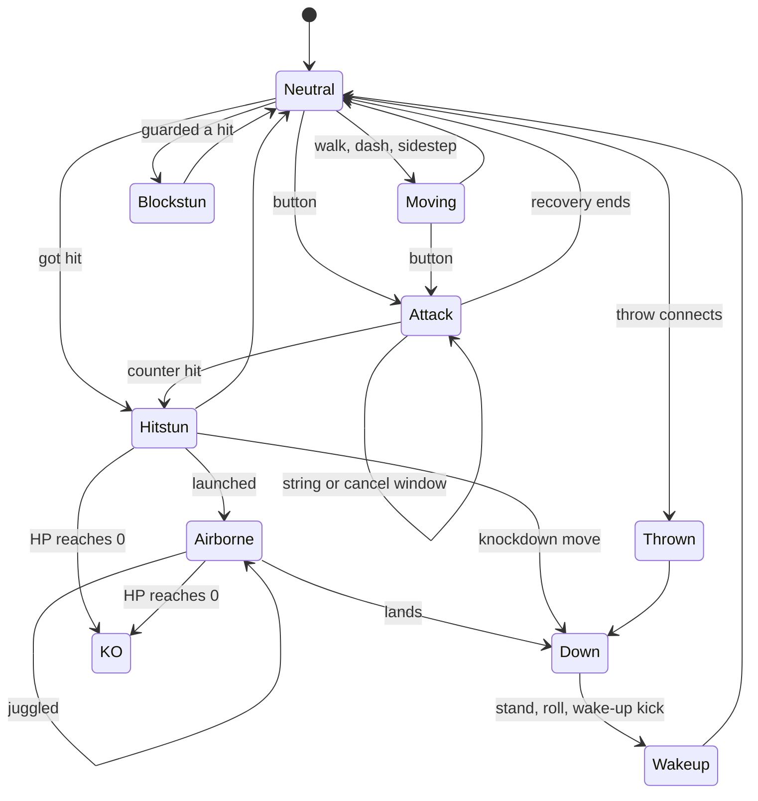
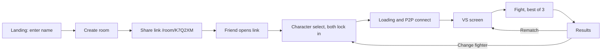
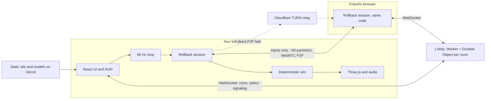
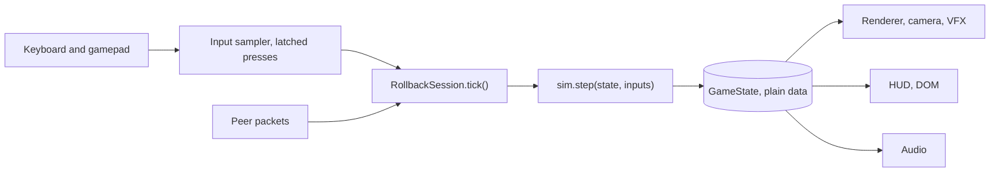
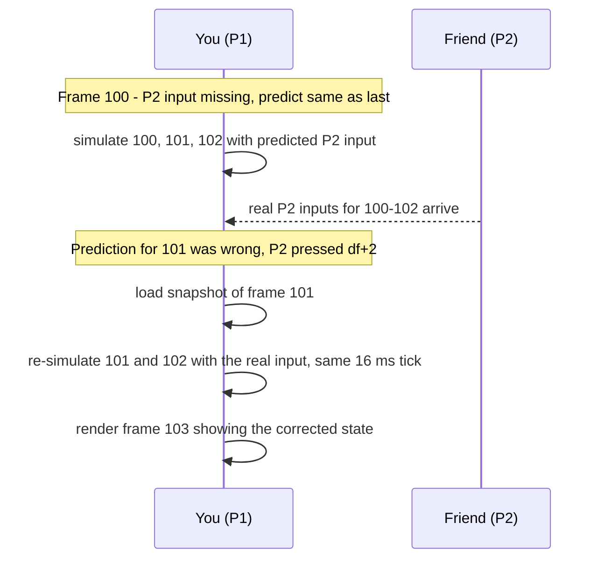
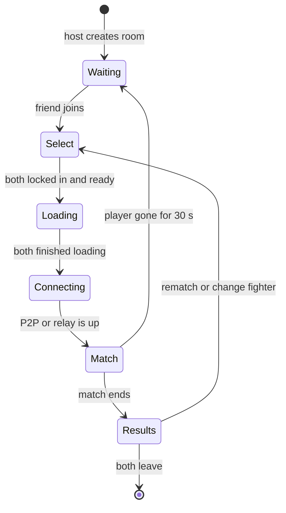
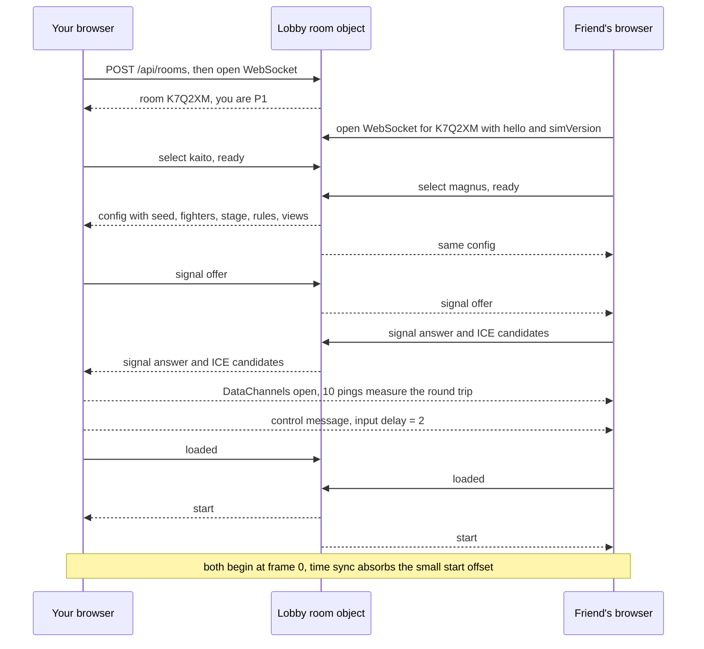

# NEON FIST — Real-Time 3D Fighting Game for the Browser

> **Working title.** A Tekken-style 1v1 3D fighter you play with a friend, each in your own browser, in real time. (A small itch.io project already uses a similar name, so pick a final title before any public release — it's a single constant in the code.)
>
> **Status:** Plan v1.1 · 28 Oct 2026 · Owner: Edwin · Repo: `iron-arena` (game title NEON FIST)
>
> **Update (29 Oct 2026): the game is now a 3D arena brawler** — free movement on a round rooftop, attack/guard/jump with skill chords, four heroes with 3 skills + 1 ultimate each, ring-outs. See **docs/GAME.md**; §2 below describes the original fighter and is kept for reference. Sections 4–12 (architecture, rollback netcode, lobby, transport, tooling) still apply unchanged.
>
> **Build status (28 Oct 2026):** Phases 0–3 and most of Phase 5 are built — deterministic sim with both fighters, local versus, training, rollback netcode over WebRTC/TURN/relay, Cloudflare lobby, HUD, audio, anime VRM rendering with procedural poses. Verified: synctest all pairs, soak 0 mismatches over 300 networks, two-browser e2e over WebRTC and relay. Still to do: original VRoid models for Kaito and Magnus (docs/CHARACTERS.md), sidestep and walls (Phase 4), deploy.
>
> **How to use this file:** save it as `docs/PLAN.md` in the repo. Every phase in §9 ends with a prompt you paste into Claude Code; the prompts point back to sections of this file.

---

## Contents

0. TL;DR — the decisions that matter
1. Vision & scope
2. Game design
3. Art & audio direction
4. Technical architecture (netcode)
5. Client implementation
6. Data models & protocols
7. Tech stack
8. Repository structure
9. Roadmap & Claude Code prompts
10. Testing & QA
11. Performance budget
12. Hosting, deployment & cost
13. Risks & mitigations
14. Glossary
15. References
- Appendix A — Controls
- Appendix B — Formulas & helpers
- Appendix C — Tested reference netcode

---

## 0. TL;DR — the decisions that matter

| Topic | Decision | Why |
|---|---|---|
| Genre | 3D fighter in the Tekken style: one button per limb (`1 2 3 4`), high/mid/low, sidestep, launchers & juggles, walls | Depth comes from frame data and spacing, not long special-move lists |
| Online | **Peer-to-peer rollback netcode (GGPO-style)** over a WebRTC DataChannel. Only inputs travel: ~60 tiny packets per second | Rollback hides lag better than anything else; it's the fighting-game standard |
| Simulation | Deterministic, fixed 60 Hz, pure TypeScript, **integer math**, no physics engine | Both browsers must compute the identical fight from the same inputs |
| Server | Tiny lobby only: room codes, character select, WebRTC signaling, TURN credentials, relay fallback. Cloudflare Worker + one Durable Object per room | No game logic on a server → ≈ $0 |
| Connectivity | Direct P2P → Cloudflare TURN (1,000 GB/month free) → WebSocket relay as last resort | Many home and mobile networks can't connect peer-to-peer directly |
| Client | Next.js + React for menus/HUD, **vanilla Three.js** for the fight scene | Your stack; vanilla three keeps the frame loop fully under control |
| Look | Stylized anime cel-shading, 2 original fighters for v1 | Cheaper to make, readable at 60 fps, runs on laptops |
| Build order | **Netcode before art** — capsules fighting online by ~week 6 | Rollback is notoriously hard to bolt on later |
| Proof | The rollback core in Appendix C is already prototyped and tested: **0 desyncs over 1.7 million compared frames** on 300 simulated networks | You start from working code, not theory |

---

## 1. Vision & scope

### 1.1 Pitch
Send a link, your friend opens it, you both pick a fighter and fight — and it feels like sitting on the same couch, even though you're in different cities.

### 1.2 Pillars
1. **Feels offline.** Your inputs respond instantly; network hiccups are hidden by rollback.
2. **Readable and fair.** Every move has honest frame data; high/mid/low is always readable from the animation.
3. **Fight within 30 seconds.** No account, no install: link → character select → fight.
4. **Stylish.** Anime cel-shading, heavy hit effects, bold UI.

### 1.3 Scope

| | v1 (MVP) | Later | Not planned |
|---|---|---|---|
| Modes | Online friend room, local versus, training | Replay browser, CPU opponent, spectators | Public ranked matchmaking at launch |
| Fighters | 2 (Kaito Arashi, Magnus Thorne) | +1 per release | |
| Stages | 1 walled rooftop arena | 2–3 more, wall breaks | Destructible stages |
| Systems | Movement, guard, frame data, strings, launchers, juggles, throws, sidestep, walls, wake-up | Surge meter + super moves | Tag team, items |
| Platforms | Desktop Chrome / Edge / Firefox; keyboard + gamepad | Safari polish, touch controls | Native apps |
| Accounts | None (display name only) | Optional login, stats | Payments |

### 1.4 Original IP only
Genre mechanics (four limb buttons, frame data, sidestep) are free to use. Tekken's names, characters, move names, UI, music, voice lines and models are not. NEON FIST uses only original characters, names and art, plus assets whose licenses allow game use (§3.2), all listed in `CREDITS.md`.

---

## 2. Game design

### 2.1 Controls & notation

| Notation | Meaning |
|---|---|
| `1` `2` `3` `4` | Left punch, right punch, left kick, right kick |
| `f` `b` `u` `d` | Forward (toward the opponent), back, up, down. Diagonals: `df`, `db`, `uf`, `ub` |
| `d+3` | Hold down, press 3 |
| `1+2` | Press together (2-frame leniency) |
| `1,2` | Press in sequence |
| `f,f` | Tap forward twice (dash) |
| `SS` | Sidestep |
| `i15` | Startup: the move hits on its 15th frame |
| `+3` / `−12` | Frame advantage after the move (positive = you act first) |
| `KND` / `LAUNCH` / `SPLAT` | Knockdown / launches into a juggle / wall splat |

Default bindings are in Appendix A. On keyboard, `U I` over `J K` mirrors the arcade layout (punches on top, kicks below). Everything is rebindable.

### 2.2 Match rules
- 200 HP per round, 60-second round timer, first to 2 rounds (option: first to 3).
- KO wins the round. Time-out: higher HP wins. Double KO or equal HP: both get the round; if that ends the match tied, play one more round.
- Each round: intro 120 f ("ROUND 1") → "FIGHT!" 30 f → fight → KO sequence 150 f (first 60 f in slow motion) → reset positions (1.6 m apart, stage centre).
- All of this runs inside the deterministic simulation (counted in frames), so both players see exactly the same round flow.

### 2.3 Movement (starting values — tune in playtests)

| Action | Input | Starting value |
|---|---|---|
| Walk forward / back | hold `f` / `b` | 40 / 33 mm per frame (2.4 / 2.0 m/s) |
| Dash | `f,f` | 12 f, 1.2 m |
| Backdash | `b,b` | 18 f, 1.0 m |
| Crouch | hold `d`, `db` or `df` | High hurtbox removed (ducks highs) |
| Jump | hold `u`, `ub` or `uf` | ~40 f arc; out of reach of lows on frames 6–30 |
| Sidestep (Phase 4) | tap `u` / tap `d` | 14 f, curves ~25° around the opponent; evades non-homing moves |
| Wake-up (Phase 4) | after a knockdown | Stand in place, back roll, side roll, or wake-up kick |
| Throw break | `1` or `2` (matching the throw) | Within 15 f of being grabbed |

### 2.4 Guard, heights and hit rules
Tekken-style guard: standing still or holding `b` = **standing guard**; holding `d` or `db` = **crouching guard**; holding `df` crouches *without* guarding (it's the input for `df` moves).

| Attack height | vs standing guard | vs crouching guard | Role |
|---|---|---|---|
| High | Blocked | **Whiffs** (ducked) | Fast pokes, beaten by crouching |
| Mid | Blocked | **Hits** | Safe pressure; launchers are mids |
| Low | **Hits** | Blocked | Mix-up; usually very unsafe on block |
| Throw | Break with the matching button | **Whiffs** | Beats players who only guard |

Rules:
- No guard while attacking (startup, active or recovery), in hitstun, airborne or knocked down.
- **Counter hit (CH):** hitting the opponent during the startup or active frames of their attack adds +6 frames of hitstun; some moves get special CH effects (e.g. knockdown).
- **Punish:** a move that's −10 or worse on block can be punished by an `i10` jab; −15 or worse by an `i15` launcher. Design rule: launchers are −12 to −15 on block, so a wrong guess costs you.
- **Two-phase hit resolution:** each frame, first collect hitbox-vs-hurtbox contacts for *both* fighters from positions at the start of the frame, then apply them together. If both hit each other on the same frame it's a **trade** (both take damage). This prevents a hidden "P1 always wins ties" bias.

Fighter states (simplified):



### 2.5 Frame data, combos, throws

```
frame:  1 ......... 14 | 15  16  17 | 18 ......................... 41
        startup         |   active   |   recovery
        i15 = the first active frame is frame 15
```

Moves are authored in **advantage** (how designers think) and the engine derives stun (Appendix B):
- `blockstun = onBlock + (active − 1) + recovery`
- `hitstun = onHit + (active − 1) + recovery`

Combos and properties:
- **Strings** (`1,2`, …): a "natural combo" string guarantees the 2nd hit if the 1st hits. Built with cancel windows in `MoveData` (§6.2).
- **Launch & juggles:** launchers send the opponent airborne (no guard possible). Each air hit adds a small upward pop; gravity grows slightly per hit; damage scales per hit (Appendix B); max 10 hits; one **extender** move per combo (property `extender`) bounces them once more for an ender.
- **Walls (Phase 4):** square arena with walls. `wallSplat` moves pin the opponent for ~30 f, allowing a short follow-up.
- **Knockdown & wake-up:** downed fighters can be hit by `groundHit` moves and choose a wake-up option (§2.3).
- **Throws:** `1+3` (break with `1`) and `2+4` (break with `2`), `i12`, range ~0.9 m, whiff on crouching opponents. A broken throw pushes both apart to neutral.
- **Properties:** `homing` (hits sidestepping opponents), `highCrush` (ducks highs on listed frames), `lowCrush` (airborne, jumps lows), `armor` (absorbs one high/mid hit, still takes the damage), `knockdown`, `launch`, `wallSplat`, `groundHit`, `extender`.

### 2.6 Fighters (v1)
Setting: **The Skyline Crown** — an underground tournament fought on the neon rooftops of a city that never sleeps. Whoever holds the crown rules the skyline. The v1 stage is **Skyline Rooftop**.

#### Kaito Arashi — "The Storm Prodigy" (all-rounder, evasive)
A young kickboxing prodigy with a street-fighting streak. Style: Storm-Step Kickboxing — quick kicks, sweeps and takedowns. The easiest fighter to learn.

| Input | Name | Hits | Startup | Block | Hit | Dmg | Notes |
|---|---|---|---|---|---|---|---|
| `1` | Quick Jab | high | i10 | +1 | +8 | 7 | Fastest move; main punisher |
| `1,2` | Storm One-Two | high, high | i10 | −3 | +5 | 7, 10 | Natural combo |
| `2` | Straight Right | high | i11 | −2 | +6 | 12 | |
| `3` | Front Snap Kick | mid | i14 | −6 | +4 | 13 | Pushes back |
| `4` | Crescent Moon Kick | high | i13 | −8 | +4 | 16 | CH: knockdown |
| `d+1` | Low Jab | low | i10 | −6 | +4 | 5 | From crouch; ducks highs |
| `d+3` | Shin Kick | low | i15 | −13 | +2 | 12 | Main low poke |
| `d+4` | Typhoon Sweep | low | i18 | −23 | KND | 18 | Launch-punishable on block |
| `df+1` | Spear Elbow | mid | i13 | −1 | +7 | 12 | Safe mid check |
| `df+2` | Skyward Uppercut | mid | i15 | −12 | LAUNCH | 13 | Main launcher |
| `f,f+3` | Comet Kick | mid | i16 | −7 | KND | 18 | Combo ender; splats near walls |
| `b+3` | Phantom Kick | mid | i17 | −9 | +6 | 15 | High crush on frames 4–16 |
| `b+1+2` | Thunder Palm | mid | i20 | +3 | KND | 22 | Big pushback; wall splat |
| `SS+2` | Cyclone Backfist | high | i14 | −4 | +6 | 14 | Homing (Phase 4) |
| `1+3` | Hip Toss | throw | i12 | — | — | 35 | Break with `1` |
| `2+4` | Scissor Takedown | throw | i12 | — | — | 38 | Break with `2`; switches sides |

**Starter combo:** `df+2` → `1` → `1,2` → `f,f+3` = 13 + 7 + 5 + 7 + 10 = **42 damage** after scaling.

#### Magnus Thorne — "The Iron Mountain" (heavy power)
A retired cage-fighting champion turned rooftop legend. Style: Pit Wrestling and bare-knuckle boxing — slow, huge damage, armor, a command grab.

| Input | Name | Hits | Startup | Block | Hit | Dmg | Notes |
|---|---|---|---|---|---|---|---|
| `1` | Heavy Jab | high | i10 | +1 | +8 | 8 | |
| `1,2` | Heavy Jab → Hammer Cross | high, high | i10 | −5 | +4 | 8, 14 | Natural combo |
| `2` | Hammer Cross | high | i13 | −4 | +5 | 15 | |
| `3` | Battering Ram | mid | i15 | +2 | +6 | 14 | Huge pushback, keeps opponents out |
| `4` | Wrecking Ball | high | i16 | −10 | KND | 24 | Slow, huge |
| `d+1` | Low Jab | low | i11 | −6 | +4 | 6 | |
| `d+3` | Quake Stomp | low | i17 | −12 | +3 | 14 | Ground hit |
| `df+2` | Avalanche Uppercut | mid | i16 | −14 | LAUNCH | 16 | Launcher |
| `b+2` | Iron Wall Hook | mid | i22 | −6 | KND | 26 | Armor on frames 6–21 vs high/mid |
| `f,f+2` | Bull Rush | mid | i18 | −8 | SPLAT | 22 | Wall splat |
| `f+1+2` | Landslide | throw | i18 | — | — | 45 | Command grab; break with `1+2`; whiffs on crouch |
| `1+3` / `2+4` | Brute Suplex / Bear Hug Crusher | throw | i12 | — | — | 35 / 38 | Break with `1` / `2` |

**Starter combo:** `df+2` → `1` → `2` → `f,f+2` = 16 + 8 + 12 + 15 = **51 damage** after scaling.

> These numbers are first drafts. Tuning rule of thumb: fast = weak and safe, slow = strong and unsafe. Every fighter needs an `i10` jab, a safe mid, a launch-punishable low, and a launcher around −12 to −15.

### 2.7 Facing & input mapping (must be deterministic)
"Forward" depends on which side you're on, and the "always on the left" camera option (§2.8) flips the screen for one player. If each client converted inputs using its own camera, the two simulations would disagree. So:

1. Clients send **raw** inputs exactly as pressed, in their own screen space: the 8 bits `U D L R 1 2 3 4` (Appendix C). Nothing else.
2. `MatchConfig.viewMirrored[p]` tells the simulation which players use the mirrored view.
3. Inside the simulation, per player: apply SOCD cleaning (left+right = neutral, up+down = neutral), swap `L`/`R` if `viewMirrored[p]`, then convert to forward/back from the sim's own side state (`p1OnLeft`) — never from the camera.
4. Sidestep direction: tap `u` means "into my screen". In canonical (P1-camera) terms that is `background = tappedUp XOR viewMirrored[p]`.
5. Jump (hold `u`) and crouch (hold `d`) don't depend on the view.
6. `p1OnLeft` (side switch) only updates when both fighters are grounded and have passed each other by a small dead zone (~50 mm), so inputs don't flip mid-jump.

### 2.8 Camera & game feel
Camera (render-only; never affects the simulation):
- Looks at the midpoint between the fighters (+1.0 m up), placed perpendicular to the line between them.
- Distance = clamp(2.2 m + 0.55 × separation, 3.0 m, 6.5 m); height 1.4 m; smoothed with a critically damped spring.
- Canonical view shows P1 on the left. With **"Always on the left"**, that player's camera sits on the opposite side of the fighters (inputs handled by §2.7).
- No camera cuts during play; cinematic angles only for round intros and KOs.

| Effect | Lives in | Starting values |
|---|---|---|
| Hitstop (both fighters freeze on impact) | Simulation (`hitstop` counter; inputs still buffered) | light 5 f, medium 7 f, heavy 10 f, CH +3 f, KO 18 f |
| KO slow motion | Simulation (`slowmo`: fighters update every 3rd frame for 60 f) | |
| Screen shake | Render | 4–12 px, 150–250 ms by hit strength |
| Hit sparks | Render | hit = warm white/orange, block = cyan, CH = red + "COUNTER" |
| Cut-ins | HUD | ROUND 1 · FIGHT! · COUNTER HIT · K.O. · PERFECT · TIME |
| Gamepad rumble | Render | Heavy hits and KO |

Rule: anything that changes **when** things happen (hitstop, slow motion) belongs to the simulation; anything purely visual belongs to rendering.

### 2.9 Player flow



- Target: link click → first "FIGHT!" in **under 30 seconds**.
- Rematch keeps the peer-to-peer connection open.

### 2.10 Modes

| Mode | Phase | Notes |
|---|---|---|
| Online friend room | 2 | The core of v1 |
| Local versus | 1 | Two players on one keyboard or two gamepads; also the main dev testbed |
| Training | 1 (basic) → 6 (full) | Dummy stance/guard (none, all, random, after first hit), record & playback, frame data readout, hitboxes, input display, position reset |
| Replays | 6 | A match = `MatchConfig` + input log (a few KB per minute), re-simulated on playback |
| Later | — | CPU opponent, spectators (receive both input streams with a delay), ranked |

---

## 3. Art & audio direction

### 3.1 Visual style
- **Anime cel-shading:** 2–3 band toon ramp, inverted-hull outlines, rim light, saturated palette. Night rooftop arena with neon signs (original text and logos).
- **UI:** high contrast, slanted panels, heavy display type, fast diagonal cut-ins — anime/JRPG energy with your own designs.
- **Why stylized:** cheaper to make than realistic, instantly readable at 60 fps, runs on integrated GPUs.

### 3.2 Characters & animation sourcing

> **Decision (28 Oct 2026): anime / cel-shaded VRM, all free.** Fighters are VRM models made in VRoid Studio (free) and posed in code from the simulation state (`apps/web/src/game/render/poses.ts`), so no animation clips are needed and every strike hits full extension on its first active frame. Free sample VRMs stand in until the originals exist; see `docs/CHARACTERS.md`. The table below is the alternative path if you later want hand-made or mocap clips.

| Need | Prototype (Phases 1–3) | v1 final |
|---|---|---|
| Body | Mixamo stock character or a Quaternius base character | Original model: Blender (yourself or commissioned), or AI image-to-3D plus cleanup (check that tool's commercial license) |
| Rig | Mixamo auto-rigger | Mixamo, AccuRIG 2, or Blender Rigify. **One humanoid skeleton for every fighter** so clips can be shared and retargeted |
| Animations | Mixamo + Quaternius Universal Animation Library 1 & 2 | Custom fighting animations (Blender or Cascadeur), retimed to the frame data (§5.2) |

Tool status (checked October 2026):
- **Mixamo:** still free with an Adobe ID; characters and animations are royalty-free, including for commercial games; auto-rigging works for humanoids only. It's in maintenance mode (no new development; its backend briefly broke in June 2025), so download everything you use and keep local copies.
- **Quaternius Universal Animation Library 2:** 130+ CC0 animations, including melee combos — 3- and 4-hit combos split into separate hits with their recoveries, ideal raw material for strings. The free standard version is about 70% of the pack. UAL 1 is compatible with common rigs such as Mixamo's.
- **AccuRIG 2 (Reallusion):** free auto-rigger for Windows; exporting needs a free ActorCore account.
- **Cascadeur:** physics-assisted keyframe animation; the free tier is non-commercial, the paid Indie plan adds FBX export.

Animation list per fighter (~45 clips): fighting idle; walk f/b; dash; backdash; crouch in/idle/out; jump; sidestep L/R; guard high/low; hit reactions high/mid/low plus a big CH reaction; launched; air hit; fall; knockdown idle; get-up; back roll; side roll; two throw attacks + their paired victim clips; throw break; one clip per move; intro; win pose; KO fall; time-out loss.

Tip: film yourself doing stances, punches and kicks on your phone — perfect reference for key poses and timing.

### 3.3 Audio
- **SFX:** whiffs (light/heavy), impacts (light/medium/heavy), block, counter-hit sting, KO boom, throw thud, landing, footsteps.
- **Announcer:** original English voice lines ("Round 1", "Fight!", "K.O.", "Perfect", "Time") — record your own voice with light compression and reverb.
- **Music:** one looping track per stage + a menu theme (CC0/royalty-free or commissioned).
- **Sources:** Kenney (CC0); freesound.org (check each file, prefer CC0, credit CC-BY). Everything goes in `CREDITS.md`.

---

## 4. Technical architecture

### 4.1 Big picture



| Channel | Carries | Rate |
|---|---|---|
| WebRTC DataChannel `inputs` (unreliable, unordered) | Raw inputs + acks, binary | 60 packets/s each way, ~30–50 B payload |
| WebRTC DataChannel `control` (reliable, ordered) | Ping/pong, checksums, pause, rematch | A few per second |
| WebSocket to the lobby | Room state, character select, signaling, TURN credentials, relay fallback | Event-driven |
| HTTPS / CDN | Site, models, textures, audio | Once, then cached |

### 4.2 Why peer-to-peer rollback

| Approach | How it works | At ~100 ms ping | Verdict |
|---|---|---|---|
| Delay-based lockstep | Wait for both inputs every frame; delay ≈ half the ping | 3+ frames of delay that changes with the connection; stutters on packet loss | Prototype only |
| Server-authoritative | Server simulates; clients predict and reconcile | Needs servers near both players; reconciling two fighters' animations is hard | Not for 1v1 fighters |
| **Rollback (GGPO-style)** | Both sides simulate; predict the remote input; on a wrong guess rewind and re-simulate | 1–2 frames of fixed delay; small, rare corrections | ✅ Chosen |

Rollback runs the game immediately with your own inputs and never stops to wait for the opponent; when the real input arrives, it rewinds, applies it and re-simulates within the same frame. Your own inputs are never undone. The catch: a game can use rollback only if it is deterministic, can save and load its state, and can simulate several frames within one 16.6 ms frame — and retrofitting that is expensive (one AAA studio estimated two engineer-years just for serialization). That's why NEON FIST is built rollback-first.

### 4.3 The golden rule: simulation ≠ presentation



- `packages/sim` knows nothing about browsers, Three.js, time or the network. `step(state, inputs)` advances exactly one 1/60 s frame.
- Renderer, HUD and audio **read** the state; nothing outside the sim ever writes it.
- The same sim runs in the browser and in Node (tests, synctest, replays, desync debugging).

### 4.4 Determinism rules
These go into `.claude/rules/sim-determinism.md` (§9.0) so Claude Code applies them automatically whenever it edits the sim or netcode.

1. **Integers only.** Positions in mm, velocities in mm/frame, directions as integer vectors ×1024, percentages as integers, division via `Math.trunc`. (Plain `+ − × ÷` on doubles are reproducible, but `Math.sin/cos/atan2/exp/pow` may be approximated differently by different JS engines. Integers sidestep the question and make checksums trivial.)
2. **No outside world.** No `Math.random`, `Date`, `performance.now`, timers, DOM, Three.js or network inside the sim. Randomness = seeded PRNG stored in `GameState` (Appendix C).
3. **Plain data.** `GameState` holds numbers, booleans, arrays and plain objects only — no class instances, Maps, Sets or closures — so `cloneState()` and `checksum()` cover everything.
4. **Fixed order.** Iterate P1 then P2; resolve hits in two phases (§2.4).
5. **Gameplay data ships with the sim.** Frame data, hitboxes and movement come from `packages/sim/data`, never from animation clips at runtime.
6. **Input history lives in state.** Command parsing (`f,f`, `d,df,f`) reads a ring buffer inside `FighterState`, so rollbacks restore it.
7. **Same build on both sides.** The lobby rejects a pair whose `simVersion` (git SHA) differs.
8. **Synctest in CI.** Every sim change runs the rollback-every-frame test (§10.2).

### 4.5 Rollback netcode
How it works:
1. Every 60 Hz tick, sample local input and schedule it for frame `now + inputDelay`. Send **all not-yet-acknowledged inputs** to the peer, so a lost packet is covered by the next one — no retransmits needed.
2. If the peer's input for a frame hasn't arrived, **predict** it ("same as their last confirmed input") and keep going.
3. Snapshot the state at the start of every frame (last ~12 frames).
4. When a real input arrives that differs from the prediction for an already-simulated frame F: load snapshot F, re-simulate F → now with the corrected input inside the same tick, then render.
5. Never predict more than `maxRollback` (8) frames — beyond that, wait (stall). **Time sync** makes the side that runs ahead skip an occasional tick, so neither player stalls in normal play.
6. Every second, compare checksums of a fully confirmed frame to catch desyncs (§4.10).



| Parameter | Value | Notes |
|---|---|---|
| Tick rate | 60 Hz | Fixed on both sides |
| Input delay | 1–4 frames, chosen from ping | Same value for both players (fairness); user override in settings |
| Max rollback | 8 frames | Beyond this the session stalls |
| Snapshots kept | maxRollback + 4 | Map in v1, ring buffer later |
| Packet | Every tick: 16-byte header (incl. 1-byte match epoch, so stale packets after a rematch are ignored) + 2 bytes per unacked input | Binary, Appendix C |
| Desync check | Every 60 frames | Checksum of a confirmed frame over `control` |

**Choosing input delay** — `inputDelay = clamp(ceil(pingMs / 55), 1, 4)`:

| Ping (round trip) | Input delay | Typical rollback |
|---|---|---|
| < 55 ms | 1 frame | 0–1 frames (invisible) |
| 55–110 ms | 2 frames | 0–2 frames |
| 110–165 ms | 3 frames | 1–3 frames |
| > 165 ms | 4 frames | 2–5 frames; above 250 ms show a "connection too far" warning |

From the prototype: rollback size ≈ `one-way delay in frames − inputDelay`, and stalls start once the one-way delay (including jitter) exceeds `inputDelay + maxRollback`.

**Prototype results** (Appendix C code, simulated network, toy sim with walking and jabs):

| Simulated network | One-way delay | Loss | Input delay | Avg / max rollback | Stalled ticks |
|---|---|---|---|---|---|
| LAN | 0 ms | 0% | 2 | 0 / 0 | 0 |
| Good | 33 ms (≈ 67 ms ping) | 0% | 2 | 0 / 0 | 0 |
| OK | 50–83 ms (≈ 100–170 ms ping) | 5% | 2 | 2.0 / 5 | 0 |
| Rough | 83–133 ms (≈ 170–270 ms ping) | 10% | 2 | 4.4 / 7 | ~0 |
| Very bad | 133–200 ms (≈ 270–400 ms ping) | 20% | 3 / 1 | 6.6 / 8 | 13% (game slows) |
| One player starts 20 ticks late | 33–50 ms | 2% | 2 | 1.1 / 6 | 15, at start only (time sync recovers) |
| **300 random networks** | 0–150 ms + up to 66 ms jitter, reordering, late start | 0–25% | 0–3 | — | **0 desyncs in 1,718,067 compared frames** |

**Performance:** a worst-case rollback re-simulates 8 frames inside one tick. Budget **≤ 0.3 ms per `step()` including the clone** → ≤ 2.5 ms worst case, leaving the rest of the 16.6 ms frame for rendering. Later optimizations, only if profiling asks: ring buffers instead of Maps, preallocated snapshots (copy into instead of clone), or a flat `Int32Array` state.

### 4.6 Transport: WebRTC + TURN + relay

```ts
// iceServers come from the lobby: STUN + short-lived Cloudflare TURN credentials
const pc = new RTCPeerConnection({ iceServers });

// Pre-negotiated channels: same ids on both sides, no ondatachannel race
const inputs = pc.createDataChannel('inputs', { negotiated: true, id: 0, ordered: false, maxRetransmits: 0 });
const control = pc.createDataChannel('control', { negotiated: true, id: 1, ordered: true });
inputs.binaryType = 'arraybuffer';
inputs.onmessage = (e) => session.onPacket(e.data as ArrayBuffer);

// Signaling goes through the lobby WebSocket. The host (P1) offers, the guest answers.
pc.onicecandidate = (e) => { if (e.candidate) lobby.send({ t: 'signal', data: e.candidate.toJSON() }); };
// host:  await pc.setLocalDescription(); lobby.send({ t: 'signal', data: pc.localDescription!.toJSON() });
// guest: on offer → await pc.setRemoteDescription(offer); await pc.setLocalDescription(); send the answer
// both:  on a candidate → await pc.addIceCandidate(candidate)
```

Connection strategy:
1. The lobby hands out ICE servers: STUN + Cloudflare TURN credentials minted by the Worker (the TURN API key stays a Worker secret, never in the browser).
2. Not connected after 8 s → one ICE restart. Not connected after 15 s → **fall back to the WebSocket relay** through the room's Durable Object (TCP, passes strict firewalls, slightly more latency).
3. The network overlay shows the path: `DIRECT`, `TURN` or `RELAY` (from `pc.getStats()`: the selected candidate pair; a local candidate of type `relay` means TURN).

Notes:
- Mobile hotspots and many ISPs use carrier-grade NAT, where direct peer-to-peer often fails. TURN is **required**, not optional — test with a phone hotspot in Phase 2.
- Cloudflare TURN routes each player to the nearest Cloudflare data center via anycast. Pricing: the first 1,000 GB per month are free (shared with their SFU product), then $0.05/GB.
- Bandwidth: ~116 B per packet including protocol overhead → ~7 KB/s (≈ 56 kbps) per direction → ~25 MB per hour per player. Even if every match went through TURN, the free tier covers roughly 20,000 hours of play a month.
- Privacy: direct P2P lets each player see the other's IP address. Fine between friends; for strangers (later), force `iceTransportPolicy: 'relay'`.

### 4.7 Lobby & signaling server
Responsibilities: create/join rooms, presence and names, character select sync, ready check, `simVersion` check, WebRTC signaling relay, TURN credentials, match config + seed, start signal, binary relay fallback, rematch, disconnect detection, room expiry.

Implementation (recommended, free tier):
- **Cloudflare Worker + one Durable Object per room** (`env.ROOMS.idFromName(code)`): everything about a room happens in one place, naturally serialized.
- Use the **WebSocket Hibernation API** (`ctx.acceptWebSocket()`, `ws.serializeAttachment()`) so idle rooms cost nothing. In-memory fields are lost when the object hibernates — keep room state in Durable Object storage or in socket attachments.
- An alarm deletes rooms idle for 30 minutes.
- The Workers Free plan supports SQLite-backed Durable Objects with a daily request allowance (100k/day) — plenty for lobby + signaling. Relayed messages count too, so the relay stays a fallback, not the default path.
- Local dev: `wrangler dev` runs the Worker and its Durable Objects locally.
- Alternative: the same protocol on Node + `ws`, hosted in Singapore (Fly.io region `sin`) or any VPS.

Room codes: 6 characters from `ABCDEFGHJKMNPQRSTUVWXYZ23456789` (no O/0/I/1/L), e.g. `K7Q2XM`.

| Method | Path | Purpose |
|---|---|---|
| `POST` | `/api/rooms` | Create a room → `{ code }` |
| `GET` | `/api/rooms/:code/ws` | WebSocket upgrade into the room's Durable Object |
| `GET` | `/api/health` | Uptime checks |



### 4.8 Match start handshake



- The lobby generates the seed (`crypto.getRandomValues`) and builds the `MatchConfig` (§6.1), including each player's `viewMirrored` and the shared `simVersion`.
- P1 (host) picks the input delay from the median of 10 pings (§4.5) and sends it over `control`, so both use the same value.
- Loading (models, audio) finishes before `start`. The sim doesn't need assets, but the players need to see the fight.

### 4.9 Game loop, input sampling & background tabs

```ts
const STEP = 1000 / 60;
let acc = 0, last = performance.now();

function onFrame(now: number) {
  acc += Math.min(now - last, 250);   // clamp after long pauses
  last = now;
  let ticks = 0;
  while (acc >= STEP && ticks < 4) {  // catch up at most 4 frames per paint
    session.tick(input.sample());
    acc -= STEP;
    ticks++;
  }
  if (ticks === 4) acc = 0;           // badly behind: drop the debt, time sync handles the rest
  renderer.render(session.state);     // always draw the newest state (rollbacks already applied)
  hud.update(session.state);
  requestAnimationFrame(onFrame);
}
requestAnimationFrame(onFrame);
```

```ts
// Keyboard sampling with latched presses, so a tap shorter than one frame is never lost
class KeyboardSampler {
  private held = 0;
  private latched = 0;
  constructor(private bindings: Record<string, number>) {   // KeyboardEvent.code → input bit
    addEventListener('keydown', (e) => {
      const bit = this.bindings[e.code];
      if (!bit) return;
      e.preventDefault();                                     // no page scrolling on arrows/space
      if (e.repeat) return;
      this.held |= bit;
      this.latched |= bit;
    });
    addEventListener('keyup', (e) => { const bit = this.bindings[e.code]; if (bit) this.held &= ~bit; });
    addEventListener('blur', () => { this.held = 0; });     // no stuck keys after alt-tab
  }
  sample(): number { const v = this.held | this.latched; this.latched = 0; return v; }
}
```

- `KeyboardEvent.code` is the physical key position, so bindings work on any keyboard layout.
- Gamepads: poll `navigator.getGamepads()` inside `sample()`; standard mapping (Appendix A); stick deadzone 0.5.
- On 120/144 Hz monitors the sim stays at 60 Hz; the renderer simply draws more often.

**Background tabs:** when a tab is in the background, browsers stop calling `requestAnimationFrame` and timers, so that player's game freezes — even though DataChannel messages keep arriving. Handling:
1. On `visibilitychange` → hidden, send `{ t: 'pause', reason: 'hidden' }` on `control`.
2. The other player stalls naturally after 8 predicted frames; show "Opponent left the window".
3. After 15 s, offer "Claim win" or "Keep waiting".
4. On return, the 4-ticks-per-paint catch-up plus time sync bring both back in step.

### 4.10 Desync detection & recovery
- Every 60 frames each side sends `{ t: 'checksum', frame, sum }` for its newest **confirmed** frame (all inputs before it known); the receiver compares it with its own checksum for that frame (`onConfirmedFrame`, Appendix C).
- On a mismatch (always a bug): end the match as "no contest", save a **desync bundle** (MatchConfig + both input logs + checksum history) and offer it as a download.
- Debug with `tools/replay.ts`: it re-simulates the bundle in Node and prints the first frame whose checksum differs, plus a field-by-field diff of the state at that frame.
- Later: the host sends a full state snapshot to resync without ending the match.

---

## 5. Client implementation

### 5.1 Rendering (Three.js)
- Vanilla Three.js inside a client-only React component (`next/dynamic` with `ssr: false`); React never re-renders per frame.
- Start with `WebGLRenderer` as the compatibility baseline. WebGPU is now available in all major browsers, so `WebGPURenderer` is a later experiment, not a dependency.
- **Pin the exact `three` version.** In 2026 releases come every ~8–11 weeks and include breaking changes (r183 changed timers and post-processing; r186 removed older build formats). Since r183, three.js ships official `llms.txt` docs for AI coding tools — point Claude Code at them instead of relying on memory.
- Look: `MeshToonMaterial` + gradient map, inverted-hull outlines, bloom only on sparks (pmndrs `postprocessing`), one shadow-casting directional light with a tight frustum around the fighters.
- Quality presets: **Low** (no shadows, no post), **Medium** (1024² shadows, bloom), **High** (2048² shadows, MSAA, extra particles).

### 5.2 Animation driven by simulation state
Never advance an `AnimationMixer` with wall-clock time. Every render frame, set the pose from the sim state. Animation then becomes rollback-proof by construction: after a rollback, the next render simply shows the corrected pose.

```ts
// Render side — a pure function of sim state
function syncFighter(view: FighterView, f: FighterState, move?: MoveData) {
  const frame = f.moveId >= 0 ? f.moveFrame : f.stateFrame;
  const seconds = move ? clipSeconds(move.anim.keys, frame) : frame / 60;
  view.setClipTime(move ? move.anim.clip : view.clipForState(f.state), seconds); // action.time = s; mixer.update(0)
  view.blendFromPrevious(f.prevMoveId, f.prevMoveFrame, Math.min(1, f.stateFrame / 4)); // 4-frame crossfade
  view.root.position.set(f.x / 1000, f.y / 1000, f.z / 1000);  // mm → m
  view.root.rotation.y = Math.atan2(f.dirX, f.dirZ);            // floats and trig are fine in render code
}

// Retiming: map sim frames → clip seconds so the impact pose lands exactly on the first active frame
function clipSeconds(keys: [number, number][], frame: number): number {
  for (let i = 1; i < keys.length; i++) {
    const [f0, t0] = keys[i - 1], [f1, t1] = keys[i];
    if (frame <= f1) return t0 + ((t1 - t0) * (frame - f0)) / (f1 - f0);
  }
  return keys[keys.length - 1][1];
}
```

- Clips are **in place** (root translation removed); the sim owns all movement.
- Frame data owns timing. If an animation looks early or late, edit `anim.keys` — e.g. `[[0, 0], [15, 0.38], [41, 1.1]]` means "show the clip's 0.38 s pose on frame 15" — never the frame data.
- glTF models face +Z, hence `rotation.y = atan2(dirX, dirZ)`.

### 5.3 Asset pipeline
1. Source files (`.blend`, raw `.fbx`) live in `assets-src/` (Git LFS) or outside the repo.
2. In Blender: one GLB per fighter = mesh + skeleton + all clips with the names below; apply transforms; strip root motion.
3. Optimize: `gltf-transform optimize in.glb out.glb --compress meshopt --texture-compress webp` (KTX2 textures later, for GPU memory).
4. Load with `GLTFLoader` + `MeshoptDecoder`. Preload both fighters during character select.
5. Targets: ≤ 6 MB per fighter, ≤ 8 MB per stage, ≤ 15 MB before the first fight (cached afterwards).

Clip names: `idle`, `walk_f`, `walk_b`, `dash`, `backdash`, `crouch_in`, `crouch`, `crouch_out`, `jump`, `ss_l`, `ss_r`, `guard_hi`, `guard_lo`, `hit_hi`, `hit_mid`, `hit_lo`, `hit_ch`, `launched`, `air_hit`, `fall`, `down`, `getup`, `roll_b`, `roll_s`, `throw_1`, `thrown_1`, `throw_2`, `thrown_2`, `throw_break`, `intro`, `win`, `ko`, plus one clip per move (`kaito_df2`, …).

### 5.4 Hitboxes & hurtboxes
- **Hurtboxes:** 3 vertical cylinders per fighter — high (head/neck), mid (torso), low (legs) — defined per stance (stand, crouch, airborne) in `CharacterData`. Crouching removes the high cylinder (that's how highs whiff); `highCrush` / `lowCrush` frames remove one temporarily. The high/mid/low rules of §2.4 map directly onto geometry.
- **Hitboxes:** spheres in fighter-local coordinates (forward, up, right, in mm) for a frame range, e.g. `{ frames: [15, 17], at: [520, 1350, 0], r: 170 }`.
- **Collision:** local → world with the integer facing vector, then sphere vs vertical cylinder with squared distances — no square roots, no floats (Appendix B).
- **Debug overlay (F1)** draws both on top of the animated model; tune offsets until the sphere sits on the fist or foot during the active frames.

### 5.5 HUD & UI
- Menus and screens: React (Next.js routes, §8). HUD: absolutely positioned DOM over the canvas, updated **imperatively** from the loop via refs (`transform: scaleX(...)`), never through React state.
- HUD elements: names, health bars with a trailing "recent damage" segment, timer, round pips, combo counter ("5 HITS · 42 DMG"), "COUNTER HIT" flash, connection icon (green/yellow/red from ping and rollback size).
- Style: slanted panels, heavy italic display font for numbers and cut-ins, high-contrast palette.

### 5.6 Effects & sound under rollback
During a rollback the sim may re-simulate a hit (don't show it twice) or erase one that only happened in a wrong prediction (cancel it).
- The sim keeps `recentEvents` — gameplay events from the last 16 frames (hit, block, whiff, land, KO, …) — inside `GameState`, deterministic like everything else.
- The renderer diffs it on every paint:

```ts
const WINDOW = 16;
const shown = new Map<string, { frame: number; fx: Effect }>();

function syncEffects(state: GameState) {
  const live = new Set<string>();
  for (const e of state.recentEvents) {
    const key = `${e.frame}:${e.fighter}:${e.type}`;
    live.add(key);
    if (!shown.has(key)) shown.set(key, { frame: e.frame, fx: spawnEffect(e) }); // first time seen
  }
  for (const [key, s] of shown) {
    const inWindow = s.frame > state.frame - WINDOW;
    if (inWindow && !live.has(key)) { s.fx.cancel(); shown.delete(key); }  // rolled back: it never happened
    else if (!inWindow && state.frame - s.frame > 120) shown.delete(key);  // old: forget it
  }
}
```

- `cancel()` fades VFX out and stops a sound only if it started < 50 ms ago (otherwise let it finish — players rarely notice).

---

## 6. Data models & protocols

### 6.1 Simulation state

```ts
// packages/sim/src/types.ts — every number is an integer
export const PHASE = { INTRO: 0, FIGHT: 1, KO: 2, ROUND_END: 3, MATCH_END: 4 } as const;
export const FS = {
  IDLE: 0, WALK_F: 1, WALK_B: 2, DASH: 3, BACKDASH: 4, CROUCH: 5, JUMP: 6, SIDESTEP: 7,
  ATTACK: 10, BLOCKSTUN: 11, HITSTUN: 12, AIR: 13, DOWN: 14, WAKEUP: 15, THROW: 16, THROWN: 17, KO: 18,
} as const;

export interface MatchConfig {
  seed: number;
  fighters: [string, string];        // 'kaito' | 'magnus' …
  stage: string;
  roundsToWin: 2 | 3;
  roundFrames: number;               // 3600 = 60 s
  viewMirrored: [boolean, boolean];  // "always on the left" per player (§2.7)
  simVersion: string;                // git SHA, must match on both sides
}

export interface FighterState {
  x: number; y: number; z: number;           // mm
  vx: number; vy: number; vz: number;        // mm per frame
  dirX: number; dirZ: number;                // facing toward the opponent, unit vector × 1024
  hp: number; roundsWon: number;
  state: number; stateFrame: number;         // FS.* and frames spent in it
  moveId: number; moveFrame: number;         // index into the fighter's move table, -1 = none
  stun: number;                              // remaining hitstun / blockstun
  hitLanded: number;                         // 1 if the current move already connected
  comboHits: number; comboDamage: number;    // as the victim of a combo (scaling + HUD)
  juggleLeft: number; armorLeft: number;
  inputRing: number[];                       // last 32 raw inputs
  inputHead: number;
  prevMoveId: number; prevMoveFrame: number; // for render blending (§5.2)
}

export interface SimEvent { frame: number; fighter: number; type: number; x: number; y: number; z: number }

export interface GameState {
  frame: number;
  rng: number;                               // PRNG state (Appendix C)
  phase: number; phaseFrame: number;
  round: number; timer: number;              // timer in frames
  hitstop: number; slowmo: number;
  p1OnLeft: number;                          // 1 or 0 — side state used for input mapping (§2.7)
  fighters: [FighterState, FighterState];
  recentEvents: SimEvent[];                  // last 16 frames (§5.6)
}
```

### 6.2 Moves & characters

```ts
export type Height = 'high' | 'mid' | 'low' | 'throw';
export type Outcome = number | 'launch' | 'knockdown' | 'wallSplat'; // number = frame advantage

export interface MoveData {
  id: string;                  // 'kaito_df2'
  name: string;                // 'Skyward Uppercut'
  command: string;             // 'df+2' (parsed at load time)
  height: Height;
  startup: number;             // first active frame (i15 → 15)
  active: number;
  recovery: number;
  damage: number;
  onBlock: number;             // authored advantage → blockstun is derived (Appendix B)
  onHit: Outcome;
  onCounterHit?: Outcome;
  hitboxes: { frames: [number, number]; at: [number, number, number]; r: number }[]; // forward, up, right (mm)
  pushback?: { hit: number; block: number };     // mm
  hitstop?: number;
  launch?: { vy: number; vx: number };           // mm per frame
  properties?: ('homing' | 'highCrush' | 'lowCrush' | 'armor' | 'groundHit' | 'extender')[];
  crush?: { frames: [number, number]; type: 'high' | 'low' };
  armor?: { frames: [number, number]; hits: number };
  movement?: { frames: [number, number]; forward: number }[];  // mm per frame
  cancels?: { input: string; window: [number, number]; into: string }[];
  throwBreak?: number[];       // input bits that break this throw
  anim: { clip: string; keys: [number, number][] };           // sim frame → clip seconds (§5.2)
  sfx?: string; vfx?: string;
}

export interface Cylinder { r: number; y0: number; y1: number; zone: 'high' | 'mid' | 'low' }

export interface CharacterData {
  id: string; name: string; hp: number;          // 200
  walkF: number; walkB: number;                  // mm per frame
  hurt: { stand: Cylinder[]; crouch: Cylinder[]; air: Cylinder[] };
  moves: MoveData[];
  model: string;                                 // '/models/kaito.glb'
}
```

### 6.3 Example move (Kaito `df+2`)

```ts
export const kaito_df2: MoveData = {
  id: 'kaito_df2', name: 'Skyward Uppercut', command: 'df+2',
  height: 'mid', startup: 15, active: 3, recovery: 24, damage: 13,   // 41 frames total
  onBlock: -12,                                 // → blockstun = -12 + (3 - 1) + 24 = 14
  onHit: 'launch', launch: { vy: 95, vx: 18 },  // ~1.2 m apex with gravity 4 mm/frame²
  hitboxes: [{ frames: [15, 17], at: [520, 1350, 0], r: 170 }],
  pushback: { hit: 0, block: 260 }, hitstop: 10,
  movement: [{ frames: [3, 12], forward: 18 }],
  anim: { clip: 'kaito_df2', keys: [[0, 0], [15, 0.38], [41, 1.1]] },
  sfx: 'hit_heavy', vfx: 'spark_heavy',
};
```

### 6.4 Lobby protocol (WebSocket, JSON, validated with zod)

```ts
// packages/shared/src/lobby.ts
export type RoomPhase = 'waiting' | 'select' | 'loading' | 'connecting' | 'match' | 'results';
export interface PlayerInfo { name: string; fighter: string | null; ready: boolean; connected: boolean }

export type ClientMsg =
  | { t: 'hello'; name: string; simVersion: string }
  | { t: 'select'; fighter: string }
  | { t: 'ready'; ready: boolean; viewMirrored: boolean }
  | { t: 'signal'; data: unknown }                      // SDP or ICE candidate, forwarded as-is
  | { t: 'loaded' }
  | { t: 'relay'; on: boolean }                        // switch to the binary relay fallback
  | { t: 'result'; winner: 0 | 1 | -1; finalChecksum: number }
  | { t: 'rematch' }
  | { t: 'leave' };

export type ServerMsg =
  | { t: 'room'; code: string; you: 0 | 1; players: PlayerInfo[]; phase: RoomPhase }
  | { t: 'ice'; iceServers: { urls: string | string[]; username?: string; credential?: string }[] }
  | { t: 'signal'; data: unknown }
  | { t: 'config'; config: MatchConfig }
  | { t: 'start' }
  | { t: 'peer_left'; reason: 'closed' | 'timeout' }
  | { t: 'error'; code: 'ROOM_FULL' | 'NOT_FOUND' | 'VERSION_MISMATCH' | 'BAD_MESSAGE'; message: string };
```

### 6.5 Peer protocol
- `inputs` channel: binary packets (layout in Appendix C).
- `control` channel (JSON):

```ts
export type ControlMsg =
  | { t: 'ping'; id: number; sentAt: number }
  | { t: 'pong'; id: number; sentAt: number }
  | { t: 'delay'; inputDelay: number }            // host decides after the pings (§4.8)
  | { t: 'checksum'; frame: number; sum: number }  // every 60 frames (§4.10)
  | { t: 'pause'; reason: 'hidden' | 'menu' }
  | { t: 'resume' }
  | { t: 'quit' };
```

---

## 7. Tech stack

| Area | Choice | Notes |
|---|---|---|
| Language | TypeScript (strict) | One language for sim, client and lobby |
| Monorepo | pnpm workspaces (+ Turborepo, optional) | The sim package is shared by web, lobby tests and tools |
| Web app | Next.js (App Router) + React | The game page is client-only |
| Styling | Tailwind CSS | Menus and HUD |
| 3D | `three` (exact version pinned), `GLTFLoader` + `MeshoptDecoder`, `postprocessing` | No React Three Fiber in the fight scene |
| UI state | Zustand | Menus and settings only — never game state |
| Validation | zod | Every lobby and control message |
| Simulation | `@neonfist/sim`, zero dependencies | Runs in the browser and Node |
| Netcode | `@neonfist/netcode` (Appendix C) | GGPO and NetplayJS as references |
| Lobby | Cloudflare Workers + Durable Objects (`wrangler`) | Alternative: Node + `ws` on Fly.io `sin` |
| NAT traversal | Cloudflare Realtime TURN (+ STUN) | Short-lived credentials from the lobby |
| Audio | Howler.js | |
| Assets | Blender, Mixamo, Quaternius UAL 1 & 2, AccuRIG 2, gltf-transform | |
| Tests | Vitest; Playwright (Chromium, Firefox, WebKit) | Synctest + soak in CI |
| CI/CD | GitHub Actions | Tests gate every deploy |
| Hosting | Vercel (web), Cloudflare (lobby, TURN) | Subdomain of touchsimpledev.site |

---

## 8. Repository structure

```
neon-fist/
├── CLAUDE.md                        # short project rules for Claude Code (§9.0)
├── .claude/rules/
│   └── sim-determinism.md           # path-scoped to packages/sim + packages/netcode (§9.0)
├── docs/
│   ├── PLAN.md                      # this file
│   └── ASSETS.md                    # Blender export settings, naming, licenses
├── apps/
│   ├── web/                         # Next.js
│   │   ├── app/
│   │   │   ├── page.tsx             # landing: name, create/join
│   │   │   ├── room/[code]/page.tsx # lobby → select → match → results
│   │   │   ├── local/page.tsx       # local versus
│   │   │   ├── training/page.tsx
│   │   │   ├── settings/page.tsx
│   │   │   └── dev/sandbox/page.tsx # phase 0 testbed
│   │   ├── public/models/  public/audio/
│   │   └── src/
│   │       ├── game/
│   │       │   ├── loop.ts          # fixed-step loop (§4.9)
│   │       │   ├── input/           # keyboard, gamepad, latching, bindings
│   │       │   ├── render/          # scene, FighterView, camera, vfx, toon, debug overlay
│   │       │   ├── audio/
│   │       │   └── hud/             # imperative DOM HUD
│   │       ├── net/                 # lobby client, WebRTC setup, transports wiring
│   │       └── ui/                  # React screens: lobby, select, results, settings
│   └── lobby/                       # Cloudflare Worker
│       ├── src/index.ts             # routes
│       ├── src/room.ts              # RoomDO (Durable Object)
│       └── wrangler config (.jsonc or .toml)
├── packages/
│   ├── sim/
│   │   ├── src/                     # types, step, input-map, commands, movement, attacks,
│   │   │                            # collision, throws, juggle, rounds, rng, checksum, math
│   │   ├── data/characters/         # kaito.ts, magnus.ts, dummy.ts
│   │   ├── data/stages/             # skyline-rooftop.ts
│   │   └── test/                    # framedata, guard rules, combos, synctest
│   ├── netcode/
│   │   ├── src/                     # session.ts, packet.ts, transport.ts, loopback.ts,
│   │   │                            # webrtc.ts, ws-relay.ts
│   │   └── test/                    # soak.test.ts (Appendix C)
│   └── shared/                      # input bits, lobby + control protocol types, constants
├── tools/
│   ├── synctest.ts                  # CLI: rollback-every-frame determinism check
│   ├── replay.ts                    # re-simulate a replay or desync bundle in Node
│   └── assets/optimize.mjs          # gltf-transform wrapper
└── e2e/
    ├── two-player.spec.ts           # two browser contexts, one room
    └── cross-engine.spec.ts         # same replay in Chromium, Firefox, WebKit
```

---

## 9. Roadmap & Claude Code prompts

### 9.0 Set up Claude Code for this repo
Claude Code loads a project `CLAUDE.md` at the start of every session; the docs recommend keeping it under ~200 lines. Rules in `.claude/rules/` with a `paths:` frontmatter load only when Claude works on matching files — perfect for the determinism rules. Don't import this whole plan into `CLAUDE.md` (imported files also load every session and cost context); each phase prompt tells Claude which sections to read.

**`CLAUDE.md`**

```markdown
# NEON FIST — browser 3D fighting game (Tekken-style), 1v1 online with rollback netcode

Full plan: docs/PLAN.md. Before each task, read the sections of the plan that the task names.

## Layout
- packages/sim — deterministic game logic (pure TS, zero deps). Rules: .claude/rules/sim-determinism.md
- packages/netcode — rollback session, packet codec, transports
- packages/shared — input bits and protocol types
- apps/web — Next.js app; game code in src/game (render, input, audio, hud)
- apps/lobby — Cloudflare Worker + Durable Object rooms (signaling, TURN credentials, relay)

## Commands
pnpm dev · pnpm test · pnpm synctest · pnpm soak · pnpm e2e · pnpm typecheck · pnpm lint

## Rules
- Rendering, audio and HUD only READ GameState. Nothing outside packages/sim mutates it.
- Gameplay numbers (frame data, hitboxes, movement) live in packages/sim/data, never in render code.
- After any sim change: pnpm test and pnpm synctest must pass before you say it's done.
- After any netcode change: pnpm soak must report 0 mismatches.
- Pin exact dependency versions (especially three). Check three.js's official llms.txt docs instead of guessing APIs.
- Original IP only: no names, characters, art, music or audio from existing games.
```

**`.claude/rules/sim-determinism.md`**

```markdown
---
paths:
  - "packages/sim/**/*.ts"
  - "packages/netcode/**/*.ts"
---
# Determinism rules (rollback netcode depends on these)
- Integer math only: mm, mm/frame, integer percent, Math.trunc for division.
- No Math.sin/cos/atan2/pow/exp in the sim. Use isqrt() and integer direction vectors (×1024).
- No Math.random, Date, performance.now, timers, DOM, three, or network calls in the sim.
- Randomness only via rand(state, n); the PRNG state lives in GameState.
- GameState is plain data: numbers, booleans, arrays, plain objects. No Maps, Sets, classes, closures.
- Input history for command parsing lives in FighterState.
- Resolve hits in two phases: collect contacts for both fighters, then apply.
- When you add a field to GameState or FighterState, update cloneState(), checksum() and the synctest.
- step(state, inputs) advances exactly one frame and depends on nothing else.
```

**Working style per phase:** start a fresh Claude Code session, paste the phase prompt, ask it to plan before coding, review the plan, let it implement, then commit when the phase's "Done when" is met.

### 9.1 Milestones (part-time, ~10–15 h/week)

| Milestone | Week | You can… |
|---|---|---|
| M0 Foundations | 1 | Run the monorepo and see a 3D arena with two capsules and live input display |
| M1 Local fight | 3 | Fight on one keyboard with capsules: walk, guard, jab, low, launcher, rounds |
| **M2 Online fight** | **6** | **Fight your friend from two browsers with rollback — the key milestone** |
| M3 Real fighters | 9 | Kaito vs Magnus with animations, online |
| M4 Real fighting game | 12 | Juggles, throws, sidestep, walls, wake-ups |
| M5 Juice | 14 | Sparks, shake, sounds, announcer, polished HUD |
| M6 v1.0 | 16 | Training, replays, settings — live on your domain |

### Phase 0 — Foundations (week 1)
**Goal:** a clean monorepo and a 60 Hz testbed.
- [ ] pnpm monorepo: `apps/web`, `apps/lobby`, `packages/sim`, `packages/netcode`, `packages/shared`
- [ ] TypeScript strict, ESLint, Prettier, Vitest; GitHub Actions running typecheck + lint + test
- [ ] `CLAUDE.md` and `.claude/rules/sim-determinism.md` (§9.0)
- [ ] `/dev/sandbox`: Three.js arena, two capsules, side camera
- [ ] Fixed-step 60 Hz loop with FPS/tick counter (§4.9)
- [ ] Keyboard + gamepad sampler with latched presses and an on-screen input display

**Done when:** the sandbox runs at 60 FPS, the input display shows the right bits for keyboard and gamepad, and CI is green.

```text
Read docs/PLAN.md §0, §4.3, §4.9, §7, §8, §9.0 and Appendix A.

Set up the pnpm monorepo exactly as §8 describes:
- apps/web: Next.js (App Router), TypeScript strict, Tailwind
- apps/lobby: Cloudflare Worker with a Durable Object stub (wrangler) and Vitest
- packages/sim, packages/netcode, packages/shared: TypeScript libraries with Vitest
- Root: ESLint, Prettier, and a GitHub Actions workflow running typecheck, lint and test
- Create CLAUDE.md and .claude/rules/sim-determinism.md with the exact content from §9.0
- Pin exact versions (no ^ or ~) for three and next

In apps/web create a client-only page /dev/sandbox:
- Vanilla Three.js (no React Three Fiber): flat arena floor, two capsules 1.6 m apart, side camera
- The fixed-timestep 60 Hz loop from §4.9 (accumulator, max 4 catch-up ticks) with an FPS and tick counter
- The input sampler from §4.9: keyboard with latched presses (KeyboardEvent.code) plus the Gamepad API
  standard mapping, default bindings from Appendix A, and an on-screen display of the 8 input bits for both players

No gameplay yet. When finished, run typecheck, lint and tests, then show me the file tree and how to run everything.
```

### Phase 1 — Deterministic core & local versus (weeks 2–3)
**Goal:** a correct, deterministic fight on one machine.
- [ ] `types.ts` (§6.1), `cloneState`, `checksum`, PRNG (Appendix C), math helpers (Appendix B)
- [ ] Raw input → intent mapping (§2.7) + command parser (`f,f`, `b,b`, `d,df,f`) with input history in state
- [ ] Movement (§2.3): walk, dash, backdash, crouch, simple jump, stage bounds, push-apart
- [ ] Guard rules + two-phase hit resolution (§2.4), stun derived from advantage, pushback, hitstop
- [ ] Test fighter "dummy" with `1`, `2`, `d+3`, `df+2`
- [ ] Rounds, timer, KO, match end (§2.2)
- [ ] Synctest CLI + Vitest suites (§10.1–10.2)
- [ ] `/local`: two players on one keyboard or two gamepads, debug overlay F1/F2

**Done when:** all tests pass; synctest (10,000 frames, rollback 8 every frame) reports 0 mismatches; you can play best-of-3 locally and F2 shows the jab as `i10`, `+1` on block.

```text
Read docs/PLAN.md §2.1–§2.5, §2.7, §4.3, §4.4, §6.1–§6.3, §10.1–§10.2 and Appendices B and C.

Implement packages/sim as a pure, deterministic TypeScript library (follow .claude/rules/sim-determinism.md):
1. types.ts from §6.1; cloneState(), checksum() (FNV-style over every field) and the PRNG from Appendix C;
   isqrt, facing and collision helpers from Appendix B.
2. Raw input → intent mapping exactly as in §2.7 (SOCD cleaning, viewMirrored, forward/back from p1OnLeft),
   plus a command parser for f,f / b,b / d,df,f that reads the input ring buffer stored in FighterState.
3. Movement from §2.3 (walk, dash, backdash, crouch, simple jump), stage bounds, push-apart.
4. Guard rules and two-phase hit resolution from §2.4; hitstun/blockstun derived from authored advantage
   (Appendix B); pushback; hitstop.
5. A test fighter "dummy" with moves 1, 2, d+3 and df+2 as MoveData (§6.2); df+2 may simply knock down for now.
6. Round flow from §2.2 (intro, fight, timer, KO, best of 3).

Tests (Vitest): frame data of every move (blocked jab = +1, jab on hit = +8), the full guard table in §2.4,
trades, round flow, and a synctest that runs 10,000 frames of random inputs while rolling back 8 frames every
frame and asserts identical checksums. Also expose the synctest as `pnpm synctest`.

Then in apps/web add /local: two players on one keyboard (P1 WASD + U I J K, P2 arrows + numpad 4 5 1 2) or two
gamepads, capsules coloured by state (idle, attack, hitstun, blockstun), HP bars and timer, and a debug overlay:
F1 hitboxes/hurtboxes, F2 frame data of the current move.
Run all tests and the synctest before telling me you're done.
```

### Phase 2 — Online with rollback (weeks 4–6)
**Goal:** you and your friend fight capsules from two browsers.
- [ ] `packages/netcode`: port Appendix C; `Transport` interface; loopback transport; soak test
- [ ] Time sync, stalls, desync checks (§4.5, §4.10)
- [ ] Lobby Worker + room Durable Object (§4.7, §6.4) incl. TURN credentials and relay fallback
- [ ] WebRTC setup (§4.6) with ICE restart, relay fallback and path indicator
- [ ] Match start handshake (§4.8)
- [ ] `/room/[code]` flow (§2.9), minimal styling
- [ ] Network overlay F3; background-tab and disconnect handling (§4.9)
- [ ] Playwright two-player test

**Done when:** 10 matches with your friend from different houses/ISPs with no desync; a phone-hotspot connection works (shows `TURN`); the overlay shows ≤ 2 frames of rollback at your usual ping.

```text
Read docs/PLAN.md §4.1, §4.5–§4.10, §6.4, §6.5, §2.9, §10.3–§10.4 and Appendix C.

1. packages/netcode: port packet.ts and session.ts from Appendix C exactly (keep the public API), then add:
   - a Transport interface (send, onMessage, close) with LoopbackTransport (latency, jitter, loss, reordering),
     WebRtcTransport (§4.6: negotiated 'inputs' unreliable/unordered + 'control' reliable channels) and
     WsRelayTransport (fallback through the lobby)
   - the soak test from Appendix C using the real sim from packages/sim and a random input bot:
     300 configurations must give 0 mismatches. Expose it as `pnpm soak`.
2. apps/lobby: Cloudflare Worker + one Durable Object per room (idFromName(code)) using the WebSocket
   Hibernation API, implementing §4.7 and the protocol in §6.4: 6-character room codes, max 2 players,
   simVersion check, character select + ready, signaling relay, ICE servers with short-lived Cloudflare TURN
   credentials (key and token from Worker secrets, never sent to the browser), MatchConfig with a
   crypto-random seed, start, binary relay fallback, rematch, 30-minute idle expiry via an alarm.
   Unit-test the room logic.
3. apps/web: the flow in §2.9 at /room/[code] with minimal styling (create room, copy link, select the dummy,
   ready, loading, connect, start); the handshake in §4.8 (10 pings → input delay from the §4.5 formula,
   chosen by the host); desync checks every 60 frames with a desync-bundle download (§4.10); the
   background-tab and disconnect handling in §4.9; and a network overlay on F3: ping, input delay, path
   (DIRECT/TURN/RELAY), rollbacks (avg/max), stalls, packet loss.
4. A Playwright test that opens two browser contexts, joins the same room, plays 30 seconds of scripted
   inputs and asserts both reach the same final checksum.
Run unit tests, synctest, soak and the Playwright test before telling me you're done.
```

### Phase 3 — Real fighters & animation (weeks 7–9)
**Goal:** Kaito vs Magnus with real models, online.
- [ ] Prototype bodies + clips (Mixamo / Quaternius) on one shared humanoid skeleton (§3.2)
- [ ] Asset pipeline: Blender export → gltf-transform (§5.3), clip naming convention
- [ ] `FighterView` driven purely by sim state, retiming keys, frame-based crossfades (§5.2)
- [ ] Toon materials, outlines, rooftop arena blockout with walls (§3.1, §5.1)
- [ ] Kaito & Magnus move lists as data (§2.6); hitboxes tuned with the overlay (§5.4)
- [ ] Character select with 3D previews

**Done when:** Kaito vs Magnus is playable online; every move's visual impact lands within ±1 frame of its first active frame (check with F1/F2); each fighter GLB ≤ 6 MB.

```text
Read docs/PLAN.md §2.6, §2.8, §3, §5.1–§5.4 and §6.2–§6.3.

Replace the capsules with real fighters:
1. tools/assets: a script that optimizes GLBs with gltf-transform (§5.3) and reports file sizes; document the
   Blender export settings and clip naming in docs/ASSETS.md.
2. apps/web/src/game/render: a Scene (rooftop arena blockout with walls, toon materials, inverted-hull outlines,
   bloom only on sparks, the quality presets from §5.1) and a FighterView that poses the model purely from sim
   state as in §5.2 (clip time from sim frames, anim.keys retiming, 4-frame crossfade from prevMoveId, in-place
   clips, mm → m, rotation from dirX/dirZ). Never call mixer.update with wall-clock time.
3. The camera rules from §2.8, including the "always on the left" view (inputs are already handled per §2.7).
4. packages/sim/data: Kaito and Magnus as CharacterData with the full move lists from §2.6 (hitboxes as first
   guesses) and hurt cylinders per stance (§5.4).
5. The F1 overlay draws hitboxes and hurt cylinders on top of the animated models so I can tune them.
6. A character select screen with both fighters previewed in 3D.
Load models from public/models (I'll drop in Mixamo/Quaternius exports) and fall back to capsules when a model is
missing. Run all tests, the synctest and the soak before telling me you're done.
```

### Phase 4 — Combat depth (weeks 10–12)
**Goal:** it plays like a real 3D fighter.
- [ ] Strings & cancel windows; counter hits
- [ ] Launch, juggle physics, damage scaling, juggle limit, extender
- [ ] Throws + breaks; Magnus's command grab
- [ ] Knockdown, ground state, wake-up options, ground hits
- [ ] Sidestep + homing; side-switch rule (§2.7)
- [ ] Walls and wall splat
- [ ] Training dummy options

**Done when:** every rule has a unit test; both starter combos in §2.6 deal exactly the listed damage; synctest and soak still report 0 mismatches.

```text
Read docs/PLAN.md §2.3–§2.7 and Appendix B.

Add the full combat system to packages/sim, one feature at a time, each with unit tests, and run the synctest and
soak after each feature:
1. Strings and cancel windows (MoveData.cancels); counter hits (+6 hitstun, onCounterHit outcomes)
2. Launch, juggle physics (gravity 4 mm/frame², small pop per air hit), the damage scaling table, a 10-hit juggle
   limit, one extender per combo
3. Throws 1+3 / 2+4 with a 15-frame break window; Magnus's f+1+2 command grab (break with 1+2)
4. Knockdown, ground state, wake-up options (stand, back roll, side roll, wake-up kick), groundHit moves
5. Sidestep (tap u / tap d) with homing, using the side-switch rule in §2.7
6. Square arena walls and wall splat
7. Training dummy options: stand / crouch / guard all / random guard / guard after first hit / record & playback
Acceptance: a unit test proves both starter combos in §2.6 deal exactly the listed damage.
```

### Phase 5 — Game feel & presentation (weeks 13–14)
**Goal:** hits feel heavy and the game looks finished.
- [ ] Hitstop & KO slow motion (sim); screen shake, sparks, KO camera (render)
- [ ] Camera polish and "always on the left" (§2.8)
- [ ] HUD: health with trailing damage, timer, round pips, combo counter, cut-ins
- [ ] SFX, announcer and music with rollback-safe events (§5.6)
- [ ] Quality presets; 60 FPS on an integrated GPU (§11)

**Done when:** your friend says hits "feel heavy"; no doubled sounds or ghost sparks at a simulated 150 ms ping; frame time ≤ 16 ms on your laptop at Medium.

```text
Read docs/PLAN.md §2.8, §3, §5.5, §5.6 and §11.

Make it feel like a real fighting game:
1. Simulation: hitstop and KO slow motion as specified in §2.8; recentEvents (last 16 frames) as in §5.6.
2. Rendering: hit sparks by type (hit / block / counter), screen shake, KO camera, round-intro camera, and
   rollback-safe effects exactly as in §5.6.
3. HUD per §5.5: health bars with trailing damage, timer, round pips, names, combo counter, and cut-ins
   (ROUND 1, FIGHT!, COUNTER HIT, K.O., PERFECT, TIME) in a bold anime style.
4. Audio with Howler.js: SFX, announcer and music, driven by the same rollback-safe event diff.
5. Performance per §11: show frame time in the F3 overlay, finish the quality presets, and make Medium hold
   60 FPS on an integrated GPU.
Verify with the loopback transport at 150 ms ping that there are no doubled sounds or ghost sparks.
```

### Phase 6 — Modes, polish & launch (weeks 15–16)
**Goal:** a friend can go from your link to a finished match with no help.
- [ ] Training panel: frame data, input display, hitboxes, dummy record/playback, position reset
- [ ] Replays: save, play (0.5× / 1× / 2×, frame step), export/import; `tools/replay.ts`
- [ ] Settings: key and gamepad rebinding, input delay override, "always on the left", volume, quality
- [ ] Move list / how-to-play page generated from `MoveData`
- [ ] Error states: room full, not found, version mismatch, opponent left, desync
- [ ] Deploy (§12), `CREDITS.md`, manual playtest (§10.5)

**Done when:** someone who has never seen the game finishes a match from your link without help, and the §10.5 checklist is all green.

```text
Read docs/PLAN.md §2.10, §10, §12 and §13.

Finish v1:
1. Training mode panel: frame data readout, input display, hitbox toggle, dummy record/playback, position reset.
2. Replays: save MatchConfig + input logs, a replay viewer (0.5× / 1× / 2×, frame step), export/import as a file;
   tools/replay.ts re-simulates a replay or desync bundle in Node and reports the first mismatching frame.
3. Settings: keyboard and gamepad rebinding, input delay override, "always on the left", volume, quality.
4. A move list / how-to-play page for both fighters, generated from their MoveData.
5. Error states: room full, room not found, version mismatch (ask to refresh), opponent left, desync.
6. Deployment per §12: web to Vercel, lobby to Cloudflare (secrets via wrangler), simVersion = git SHA in both
   builds, and a GitHub Actions deploy on main that runs only after all tests pass.
7. CREDITS.md listing every asset and its license.
Then walk me through the manual playtest checklist in §10.5.
```

---

## 10. Testing & QA

### 10.1 Unit tests (Vitest)
- Frame data: derived stun matches authored advantage for every move of every fighter.
- Guard table (§2.4) for every height × guard combination; crush and armor frames.
- Combos: starter combo damage, scaling, juggle limit, extender rule.
- Input mapping (§2.7): SOCD, mirrored view, side switch dead zone, command parser windows.
- Round flow: KO, time-out, double KO, match end.

### 10.2 Determinism
- **Synctest:** run 10,000 frames of random inputs; every frame, roll back 8 frames, re-simulate and compare checksums. Run for every fighter pair, in CI. (The prototype synctest catches even a shallow-copied state on frame 0.)
- **Cross-engine:** Playwright plays the same recorded replay in Chromium, Firefox and WebKit, and Node replays it too — all four final checksums must match.

### 10.3 Netcode soak
The Appendix C harness with the real sim: 300 random networks (0–150 ms one-way, jitter, 0–25% loss, reordering, late start, input delay 0–3, max rollback 6–10). Requirement: **0 mismatches**. Runs in CI.

### 10.4 End-to-end
- Two Playwright browser contexts in one room, scripted inputs, identical final checksums.
- Lobby flows: room full, version mismatch, leave and rejoin, rematch.

### 10.5 Manual playtest checklist (with your friend)
- [ ] Different ISPs, both on home Wi-Fi
- [ ] One player on a phone hotspot (overlay should show `TURN`)
- [ ] One player on a VPN or office network (`TURN` or `RELAY`)
- [ ] Tab away for 5 s and for 20 s; close the tab mid-match
- [ ] 5 rematches in a row without reloading
- [ ] Keyboard vs gamepad; rebinding works
- [ ] 120/144 Hz monitor (game speed unchanged)
- [ ] Low-end laptop on the Low preset
- [ ] Firefox vs Chrome match
- [ ] Every move of both fighters: impact on the first active frame (F1/F2 overlay)

### 10.6 Debug hotkeys (dev builds)
F1 hitboxes/hurtboxes · F2 frame data · F3 network & performance · F4 input display · F5 pause + frame advance (local/training only) · F6 save a desync bundle

---

## 11. Performance budget

| Item | Budget |
|---|---|
| `step()` including clone | ≤ 0.3 ms |
| Worst-case rollback (8 frames) | ≤ 2.5 ms |
| Render at Medium (integrated GPU, 1080p) | ≤ 10 ms |
| Whole frame | < 16.7 ms (60 FPS) |
| One state snapshot | < 4 KB of plain data |
| Network | ~7 KB/s each way, including protocol overhead |
| JS for the game route | ≤ 400 KB gzipped |
| Download before the first fight | ≤ 15 MB (cached afterwards) |
| Link click → "FIGHT!" | < 30 s |

---

## 12. Hosting, deployment & cost

| Piece | Service | Cost |
|---|---|---|
| Website (Next.js) | Vercel Hobby (personal, non-commercial projects) | $0 |
| Lobby | Cloudflare Workers Free plan with SQLite-backed Durable Objects | $0 (100k requests/day) |
| TURN | Cloudflare Realtime TURN | $0 for the first 1,000 GB/month, then $0.05/GB |
| Models & audio | Served with the site (Cloudflare R2 later if needed) | $0 |
| Domain | `neonfist.touchsimpledev.site` (subdomain of your domain) | Already owned |
| **Total** | | **≈ $0/month** |

Deploy steps:
1. **Lobby:** `wrangler deploy` from `apps/lobby`; store the TURN key ID and API token with `wrangler secret put`. Use a custom domain if your DNS is on Cloudflare, otherwise the free `*.workers.dev` URL.
2. **Web:** a Vercel project with root directory `apps/web`; env `NEXT_PUBLIC_LOBBY_URL`; add `neonfist.touchsimpledev.site` as a domain (CNAME at your DNS provider).
3. **Version lock:** both builds embed `simVersion` = git SHA; CI deploys web and lobby from the same commit.
4. **Cache busting:** content hashes in model/audio filenames.
5. **Old tabs:** a player with an outdated tab gets `VERSION_MISMATCH` → "New version available — refresh".

---

## 13. Risks & mitigations

| Risk | Impact | Mitigation |
|---|---|---|
| Determinism bug (desync) | Online play breaks | Integer sim, rules file, synctest + soak in CI, checksums every second, desync bundle + replay tool |
| Players can't connect P2P | Friend can't join | TURN + WebSocket relay fallback; path indicator; hotspot test in Phase 2 |
| Animation timing ≠ hitboxes | Feels wrong or unfair | Frame data owns timing; retiming keys; overlay; ±1 frame acceptance |
| Asset production is slow | v1 slips | Prototype with Mixamo/Quaternius; stylized art; only 2 fighters |
| Scope creep | Never ships | Scope table (§1.3); milestones; netcode before art |
| Background tab freezes the game | Match hangs | Pause protocol + claim-win timeout (§4.9) |
| Version skew after a deploy | Instant desyncs | `simVersion` check in the lobby (§4.7) |
| Free tiers change | Surprise costs | Every provider is swappable (any TURN; Node lobby on Fly.io or a VPS) |
| Slow laptops | Low FPS | Quality presets; render budget; the sim catches up independently (up to 4 ticks per paint) |
| Mixamo unmaintained | Pipeline breaks | Keep local copies; AccuRIG 2 or Rigify; Quaternius CC0 clips |
| IP complaints | Takedown | Original names and designs; `CREDITS.md` with licenses |

---

## 14. Glossary

| Term | Meaning |
|---|---|
| Startup | Frames from the button press until the attack can hit (`i10` = hits on frame 10) |
| Active frames | Frames during which the hitbox can connect |
| Recovery | Frames after the active frames before you can act again |
| Frame advantage | Who acts first after a move is blocked or hits; `+2` = you act 2 frames earlier |
| Hitstun / blockstun | Frames the defender can't act after being hit / after guarding |
| Hitstop | A short freeze on impact that makes hits feel heavy |
| Punish | Hitting an opponent during the recovery of their blocked, unsafe move |
| Counter hit | Hitting an opponent during their attack's startup or active frames; extra stun |
| Launcher / juggle | A move that sends the opponent airborne / the follow-up hits while they're in the air |
| Wall splat | Opponent stuck against a wall, allowing a short follow-up |
| Okizeme ("oki") | Pressure on an opponent who is getting up |
| Whiff | An attack that misses |
| Crush | A move whose pose avoids highs (ducking) or lows (airborne) on certain frames |
| Homing | A move that tracks sidesteps |
| SOCD | Opposite directions held at once (left + right) and the rule that resolves it |
| Rollback | Rewinding and re-simulating when a predicted remote input was wrong |
| Input delay | Deliberate frames between pressing and the input taking effect, to shrink rollbacks |
| Desync | The two simulations diverge — always a determinism bug |
| STUN / TURN / ICE | WebRTC connectivity: discover your public address / relay traffic when direct fails / the process of finding a working path |

---

## 15. References

- Infil — *Netcode: explaining how fighting games use delay-based and rollback netcode*: https://words.infil.net/w02-netcode.html
- GGPO rollback networking SDK (MIT): https://github.com/pond3r/ggpo
- NetplayJS (TypeScript rollback/lockstep over WebRTC, good reading): https://github.com/rameshvarun/netplayjs — background-tab issue: https://www.github.com/rameshvarun/netplayjs/issues/76
- Cloudflare Realtime TURN: https://developers.cloudflare.com/realtime/turn/ · pricing: https://developers.cloudflare.com/realtime/sfu/pricing · FAQ: https://developers.cloudflare.com/calls/turn/faq
- Cloudflare Durable Objects pricing (Free plan, SQLite backend, WebSocket Hibernation): https://developers.cloudflare.com/durable-objects/platform/pricing
- Mixamo FAQ (Adobe): https://helpx.adobe.com/creative-cloud/faq/mixamo-faq.html · Mixamo and alternatives in 2026: https://app.cinevva.com/guides/free-character-animations-rigging
- Quaternius Universal Animation Library 2: https://quaternius.itch.io/universal-animation-library-2 · UAL 1: https://quaternius.itch.io/universal-animation-library · overview: https://80.lv/articles/get-this-animation-asset-library-with-over-130-diverse-items
- AccuRIG 2: https://www.cgchannel.com/?p=168596
- Three.js: https://github.com/mrdoob/three.js · 2026 release-cadence summary: https://www.mind-verse.de/news/three-js-boom-ki-coding-webgpu-analyse-ed0965d1ad11 · WebGPU status: https://www.utsubo.com/blog/threejs-2026-what-changed
- Fly.io regions (Singapore `sin`): https://fly.io/docs/reference/regions
- Claude Code — CLAUDE.md and `.claude/rules/`: https://code.claude.com/docs/en/memory

---

## Appendix A — Controls

**Keyboard**

| Action | P1 / online | Local P2 |
|---|---|---|
| Up / Down / Left / Right | `W` `S` `A` `D` | `↑` `↓` `←` `→` |
| 1 (left punch) | `U` | `Numpad 4` |
| 2 (right punch) | `I` | `Numpad 5` |
| 3 (left kick) | `J` | `Numpad 1` |
| 4 (right kick) | `K` | `Numpad 2` |
| 1+2 shortcut | `O` | `Numpad 6` |
| 3+4 shortcut | `L` | `Numpad 3` |
| Pause / menu | `Esc` | `Numpad Enter` |

**Gamepad** (W3C "standard" mapping; button index in brackets)

| Action | Button |
|---|---|
| Directions | D-pad (12–15) or left stick (axes 0–1, deadzone 0.5) |
| 1 | X / □ — left face button (2) |
| 2 | Y / △ — top face button (3) |
| 3 | A / ✕ — bottom face button (0) |
| 4 | B / ○ — right face button (1) |
| 1+2 shortcut | RB / R1 (5) |
| 3+4 shortcut | RT / R2 (7) |
| Pause | Start / Options (9) |

Shortcuts simply set two bits; the sim needs no special handling.

---

## Appendix B — Formulas & helpers
All verified in the prototype (2 million `isqrt` checks, frame-data and geometry checks).

```ts
// packages/sim/src/math.ts

// Author moves in advantage; derive stun (contact on the first active frame)
export function stunFromAdvantage(advantage: number, active: number, recovery: number): number {
  return advantage + (active - 1) + recovery;
}
// jab: active 2, recovery 14 → +1 on block = blockstun 16, +8 on hit = hitstun 23
// launcher: active 3, recovery 24 → −12 on block = blockstun 14
// punishable when −onBlock ≥ the opponent's fastest startup (−10 vs an i10 jab)

export const JUGGLE_SCALE = [100, 100, 80, 70, 60, 50, 45, 40, 35, 30]; // % by hit index in a combo
export function scaledDamage(base: number, hitIndex: number): number {
  const pct = JUGGLE_SCALE[Math.min(hitIndex, JUGGLE_SCALE.length - 1)];
  return Math.max(1, Math.trunc((base * pct) / 100));
}
// Kaito starter: 13, 7, 7, 10, 18 → 13 + 7 + 5 + 7 + 10 = 42
// Magnus starter: 16, 8, 15, 22    → 16 + 8 + 12 + 15 = 51

// floor(sqrt(n)) with integer-only steps
export function isqrt(n: number): number {
  if (n < 2) return n;
  let x = n, y = Math.floor((x + 1) / 2);
  while (y < x) { x = y; y = Math.floor((x + Math.floor(n / x)) / 2); }
  return x;
}

// Facing toward the opponent as a unit vector × 1024
export function facingDir(fromX: number, fromZ: number, toX: number, toZ: number): [number, number] {
  const dx = toX - fromX, dz = toZ - fromZ;
  const len = isqrt(dx * dx + dz * dz);
  if (len === 0) return [1024, 0];
  return [Math.trunc((dx * 1024) / len), Math.trunc((dz * 1024) / len)];
}

// Fighter-local (forward, up, right) in mm → world mm. "Right" matches three.js (Y up, right = forward × up).
export function localToWorld(
  f: { x: number; y: number; z: number; dirX: number; dirZ: number },
  fwd: number, up: number, right: number,
) {
  return {
    x: f.x + Math.trunc((fwd * f.dirX - right * f.dirZ) / 1024),
    y: f.y + up,
    z: f.z + Math.trunc((fwd * f.dirZ + right * f.dirX) / 1024),
  };
}

// Hit sphere vs vertical hurt cylinder — squared distances only
export function sphereHitsCylinder(
  sx: number, sy: number, sz: number, r: number,
  cx: number, cz: number, cr: number, y0: number, y1: number,
): boolean {
  if (sy + r < y0 || sy - r > y1) return false;
  const dx = sx - cx, dz = sz - cz, rr = r + cr;
  return dx * dx + dz * dz <= rr * rr;
}
// Check from the prototype: a jab sphere at head height hits a standing head cylinder
// (y 1350–1800) and whiffs over a crouching one (y 900–1150).
```

---

## Appendix C — Tested reference netcode
This is the exact code that produced the results in §4.5 (Node 22, TypeScript): **0 mismatches across 1,718,067 confirmed frames** on 300 random simulated networks. Port it as-is in Phase 2; it is generic over your simulation through `SimAdapter`.

> **As built:** `packages/netcode/src/packet.ts` adds a 1-byte match **epoch** after the type byte (header 16 bytes: `[u8 type][u8 epoch][i32 start][i32 ack][i32 frame][i8 adv][u8 count]`). Each rematch bumps the epoch, and packets from an older match are dropped. Checksum control messages carry the epoch too.

### C.1 Input bits, PRNG, checksum

```ts
// packages/shared/src/input.ts — raw input bits, exactly as pressed (§2.7)
export const BTN = {
  UP: 1 << 0, DOWN: 1 << 1, LEFT: 1 << 2, RIGHT: 1 << 3,
  B1: 1 << 4, B2: 1 << 5, B3: 1 << 6, B4: 1 << 7,   // 1 2 3 4 = left punch, right punch, left kick, right kick
} as const;                                          // 16 bits on the wire: room for 8 more

// packages/sim/src/rng.ts — mulberry32; the seed lives in GameState.rng
export function rand(s: { rng: number }, n: number): number {
  s.rng = (s.rng + 0x6d2b79f5) | 0;
  let t = s.rng;
  t = Math.imul(t ^ (t >>> 15), t | 1);
  t ^= t + Math.imul(t ^ (t >>> 7), t | 61);
  return ((t ^ (t >>> 14)) >>> 0) % n;
}

// packages/sim/src/checksum.ts — FNV-1a style over int32 words. Feed it EVERY field of GameState.
export function hashInts(values: Iterable<number>): number {
  let h = 0x811c9dc5 | 0;
  for (const v of values) h = Math.imul(h ^ (v | 0), 0x01000193);
  return h >>> 0;
}
```

### C.2 Packet codec

```ts
// packages/netcode/src/packet.ts
// [u8 type][i32 start][i32 ack][i32 frame][i8 adv][u8 count][u16 × count]   (little-endian)
export const PKT_INPUT = 1;
export interface InputPacket { start: number; ack: number; frame: number; adv: number; inputs: number[] }

export function encodeInputPacket(p: InputPacket): ArrayBuffer {
  const buf = new ArrayBuffer(15 + p.inputs.length * 2);
  const v = new DataView(buf);
  v.setUint8(0, PKT_INPUT);
  v.setInt32(1, p.start, true);
  v.setInt32(5, p.ack, true);
  v.setInt32(9, p.frame, true);
  v.setInt8(13, Math.max(-128, Math.min(127, Math.round(p.adv))));
  v.setUint8(14, p.inputs.length);
  p.inputs.forEach((inp, i) => v.setUint16(15 + i * 2, inp, true));
  return buf;
}

export function decodeInputPacket(buf: ArrayBuffer): InputPacket {
  const v = new DataView(buf);
  if (v.getUint8(0) !== PKT_INPUT) throw new Error('not an input packet');
  const count = v.getUint8(14);
  const inputs: number[] = [];
  for (let i = 0; i < count; i++) inputs.push(v.getUint16(15 + i * 2, true));
  return { start: v.getInt32(1, true), ack: v.getInt32(5, true), frame: v.getInt32(9, true), adv: v.getInt8(13), inputs };
}
```

### C.3 Rollback session

```ts
// packages/netcode/src/session.ts
import { decodeInputPacket, encodeInputPacket } from './packet';

export interface SimAdapter<S> {
  step(state: S, inputs: [number, number]): void; // advance exactly one frame, in place
  clone(state: S): S;                              // deep copy (plain data)
  checksum(state: S): number;                      // uint32 hash of everything in S
}

export interface SessionOpts<S> {
  localPlayer: 0 | 1;
  inputDelay: number;   // frames of local delay (see the §4.5 table)
  maxRollback: number;  // max predicted frames before we wait (8)
  initialState: S;
  sim: SimAdapter<S>;
  send: (packet: ArrayBuffer) => void;                          // unreliable, unordered channel
  onConfirmedFrame?: (frame: number, checksum: number) => void; // desync checks, replays, tests
}

export type TickResult = 'advanced' | 'stalled' | 'skipped';

export class RollbackSession<S> {
  frame = 0;                                   // next frame to simulate
  state: S;
  readonly stats = { rollbacks: 0, resimFrames: 0, maxRollback: 0, stalls: 0, skips: 0 };
  readonly localLog: number[] = [];            // every local input by frame (replays, tests)
  readonly confirmedChecksums = new Map<number, number>(); // frame → checksum of state at frame start (last ~10 s)

  private o: SessionOpts<S>;
  private local = new Map<number, number>();   // my inputs by frame
  private remote = new Map<number, number>();  // confirmed remote inputs by frame
  private used = new Map<number, number>();    // remote input actually used to simulate a frame
  private snaps = new Map<number, S>();        // state at the START of recent frames
  private lastLocalFrame = -1;
  private remoteConfirmed = -1;                // all remote inputs <= this frame have arrived
  private remoteAcked = -1;                    // the peer has all MY inputs <= this frame
  private remoteFrame = -1;                    // newest frame number the peer reported
  private remoteAdv = 0;                       // the peer's own measured advantage
  private rollbackTo = Infinity;
  private lastChecksumFrame = -1;
  private aheadHistory: number[] = [];
  private ticksSinceSkip = 0;

  constructor(o: SessionOpts<S>) {
    this.o = o;
    this.state = o.sim.clone(o.initialState);
    for (let f = 0; f < o.inputDelay; f++) this.setLocal(f, 0); // the first `delay` frames are empty
  }

  /** Call once per 60 Hz tick with this player's raw input bits. */
  tick(localInput: number): TickResult {
    if (this.rollbackTo < this.frame) this.rollback();
    this.recordConfirmedChecksums();

    if (this.frame - this.remoteConfirmed > this.o.maxRollback) { // predicted too far ahead: wait
      this.stats.stalls++; this.sendInputs(); return 'stalled';
    }
    if (this.shouldSkipForTimeSync()) { this.stats.skips++; this.sendInputs(); return 'skipped'; }

    this.setLocal(this.frame + this.o.inputDelay, localInput);
    this.sendInputs();
    this.snaps.set(this.frame, this.o.sim.clone(this.state));
    this.simulate(this.frame);
    this.frame++;
    this.prune();
    return 'advanced';
  }

  /** Call from the transport's onmessage (any order; duplicates are fine). */
  onPacket(buf: ArrayBuffer): void {
    const p = decodeInputPacket(buf);
    for (let i = 0; i < p.inputs.length; i++) {
      const f = p.start + i;
      if (f <= this.remoteConfirmed || this.remote.has(f)) continue; // already have it
      this.remote.set(f, p.inputs[i]);
      if (f < this.frame && this.used.get(f) !== p.inputs[i]) {
        this.rollbackTo = Math.min(this.rollbackTo, f);              // we guessed wrong at frame f
      }
    }
    while (this.remote.has(this.remoteConfirmed + 1)) this.remoteConfirmed++;
    this.remoteAcked = Math.max(this.remoteAcked, p.ack);
    if (p.frame > this.remoteFrame) { this.remoteFrame = p.frame; this.remoteAdv = p.adv; }
  }

  private setLocal(f: number, input: number) {
    this.local.set(f, input);
    this.localLog[f] = input;
    this.lastLocalFrame = f;
  }

  private simulate(f: number) {
    const localIn = this.local.get(f) ?? 0;
    const known = this.remote.get(f);
    const remoteIn = known !== undefined ? known : (this.remote.get(this.remoteConfirmed) ?? 0); // predict: repeat last
    this.used.set(f, remoteIn);
    this.o.sim.step(this.state, this.o.localPlayer === 0 ? [localIn, remoteIn] : [remoteIn, localIn]);
  }

  private rollback() {
    const from = this.rollbackTo;
    const snap = this.snaps.get(from);
    if (!snap) throw new Error(`no snapshot for frame ${from} (now ${this.frame})`);
    this.state = this.o.sim.clone(snap);
    const n = this.frame - from;
    this.stats.rollbacks++; this.stats.resimFrames += n; this.stats.maxRollback = Math.max(this.stats.maxRollback, n);
    for (let f = from; f < this.frame; f++) {
      this.snaps.set(f, this.o.sim.clone(this.state));
      this.simulate(f);
    }
    this.rollbackTo = Infinity;
  }

  private sendInputs() {
    const start = this.remoteAcked + 1;
    const count = Math.max(0, Math.min(this.lastLocalFrame - start + 1, 64));
    const inputs: number[] = [];
    for (let i = 0; i < count; i++) inputs.push(this.local.get(start + i)!);
    this.o.send(encodeInputPacket({ start, ack: this.remoteConfirmed, frame: this.frame, adv: this.localAdvantage(), inputs }));
  }

  private localAdvantage(): number {
    return this.remoteFrame < 0 ? 0 : this.frame - this.remoteFrame;
  }

  // Each side measures (myFrame − peerFrame + latency). Subtracting the peer's measurement cancels the
  // latency and leaves 2 × (frames I am ahead). If I'm ahead, skip a tick now and then.
  private shouldSkipForTimeSync(): boolean {
    if (this.remoteFrame < 0) return false;
    const ahead = (this.localAdvantage() - this.remoteAdv) / 2;
    this.aheadHistory.push(ahead);
    if (this.aheadHistory.length > 32) this.aheadHistory.shift();
    const avg = this.aheadHistory.reduce((a, b) => a + b, 0) / this.aheadHistory.length;
    if (avg >= 1 && this.ticksSinceSkip >= 8) { this.ticksSinceSkip = 0; return true; }
    this.ticksSinceSkip++;
    return false;
  }

  // The state at the start of frame f is final once every input before f is confirmed.
  private recordConfirmedChecksums() {
    const upTo = Math.min(this.remoteConfirmed + 1, this.frame);
    for (let f = this.lastChecksumFrame + 1; f <= upTo; f++) {
      const s = f === this.frame ? this.state : this.snaps.get(f);
      if (!s) throw new Error(`missing snapshot for checksum frame ${f}`);
      const sum = this.o.sim.checksum(s);
      this.confirmedChecksums.set(f, sum);
      this.o.onConfirmedFrame?.(f, sum);
      this.lastChecksumFrame = f;
    }
  }

  private prune() {
    const keep = this.frame - this.o.maxRollback - 4;
    for (const k of this.snaps.keys()) if (k < keep) this.snaps.delete(k);
    for (const k of this.used.keys()) if (k < keep) this.used.delete(k);
    for (const k of this.remote.keys()) if (k < Math.min(keep, this.remoteConfirmed)) this.remote.delete(k);
    const keepLocal = Math.min(keep, this.remoteAcked + 1);
    for (const k of this.local.keys()) if (k < keepLocal) this.local.delete(k);
    for (const k of this.confirmedChecksums.keys()) if (k < this.frame - 600) this.confirmedChecksums.delete(k);
  }
}
```

Wiring it up:

```ts
const session = new RollbackSession<GameState>({
  localPlayer: you,                                   // 0 or 1, from the lobby
  inputDelay,                                         // from the ping handshake (§4.8)
  maxRollback: 8,
  initialState: createInitialState(matchConfig),
  sim: { step, clone: cloneState, checksum },
  send: (pkt) => inputsChannel.send(pkt),
  onConfirmedFrame: (frame, sum) => {
    if (frame % 60 === 0) control.send(JSON.stringify({ t: 'checksum', frame, sum })); // §4.10
  },
});
inputsChannel.onmessage = (e) => session.onPacket(e.data as ArrayBuffer);
// in the loop (§4.9): session.tick(input.sample()); then render session.state
```

### C.4 Soak test harness

```ts
// packages/netcode/test/soak.ts — two sessions over a fake lossy, jittery, reordering network,
// compared frame by frame with a reference run that knows every input.
import { RollbackSession, type SimAdapter } from '../src/session';

export function makeRng(seed: number) {
  let a = seed | 0;
  return () => {
    a = (a + 0x6d2b79f5) | 0;
    let t = a;
    t = Math.imul(t ^ (t >>> 15), t | 1);
    t ^= t + Math.imul(t ^ (t >>> 7), t | 61);
    return ((t ^ (t >>> 14)) >>> 0) / 4294967296;
  };
}

export interface NetCfg {
  latency: number; jitter: number; loss: number;  // one-way delay and jitter in ticks, loss 0..1
  delay: [number, number]; lateStart: number;     // input delay per player, P2 start offset in ticks
  maxRollback: number; ticks: number; seed: number;
}

export function runNet<S>(sim: SimAdapter<S>, initial: () => S, makeBot: (seed: number) => () => number, cfg: NetCfg) {
  const rng = makeRng(cfg.seed);
  const queue: { at: number; to: 0 | 1; buf: ArrayBuffer }[] = [];
  const confirmed = [new Map<number, number>(), new Map<number, number>()];
  let tick = 0;
  const peers = ([0, 1] as const).map((p) => new RollbackSession<S>({
    localPlayer: p, inputDelay: cfg.delay[p], maxRollback: cfg.maxRollback, initialState: initial(), sim,
    onConfirmedFrame: (f, sum) => confirmed[p].set(f, sum),
    send: (buf) => {
      if (rng() < cfg.loss) return;                                        // packet lost
      const at = tick + cfg.latency + Math.floor(rng() * (cfg.jitter + 1));
      queue.push({ at, to: p === 0 ? 1 : 0, buf });
    },
  }));
  const bots = [makeBot(cfg.seed * 7 + 1), makeBot(cfg.seed * 7 + 2)];
  for (tick = 0; tick < cfg.ticks; tick++) {
    for (let i = queue.length - 1; i >= 0; i--) {                          // newest first = reordering
      if (queue[i].at <= tick) peers[queue[i].to].onPacket(queue.splice(i, 1)[0].buf);
    }
    peers[0].tick(bots[0]());
    if (tick >= cfg.lateStart) peers[1].tick(bots[1]());
  }
  // Reference run: the same inputs, no network, no prediction
  const n = Math.min(peers[0].localLog.length, peers[1].localLog.length);
  const ref = initial();
  const refSums: number[] = [];
  for (let f = 0; f < n; f++) { refSums.push(sim.checksum(ref)); sim.step(ref, [peers[0].localLog[f], peers[1].localLog[f]]); }
  let compared = 0, mismatches = 0;
  for (const m of confirmed) for (const [f, sum] of m) {
    if (f < n) { compared++; if (refSums[f] !== sum) mismatches++; }
  }
  return { compared, mismatches, stats: peers.map((p) => p.stats) };
}

// The random configurations used for the §4.5 results:
// for i in 0..299 with r = makeRng(1000 + i):
//   latency = floor(r() * 10), jitter = floor(r() * 5), loss = r() * 0.25,
//   delay = [floor(r() * 4), floor(r() * 4)], lateStart = floor(r() * 30),
//   maxRollback = 6 + floor(r() * 5), ticks = 3000, seed = 5000 + i
// makeBot(seed): holds a random input (idle, walk, crouch, buttons) for 2–13 frames, like a human.
// Requirement: mismatches === 0 for every configuration.
```

Notes:
- `Map`s keep the code readable; switch to ring buffers and preallocated snapshots only if profiling shows GC pressure.
- `confirmedChecksums` keeps ~10 s of history so a peer's checksum message can be compared on arrival.
- The prototype's synctest also confirmed the value of §10.2: a deliberately shallow-copied state (`{ ...state }`) is caught on the very first frame.
